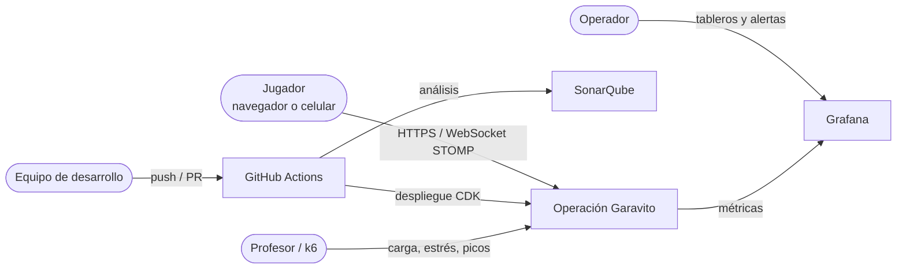
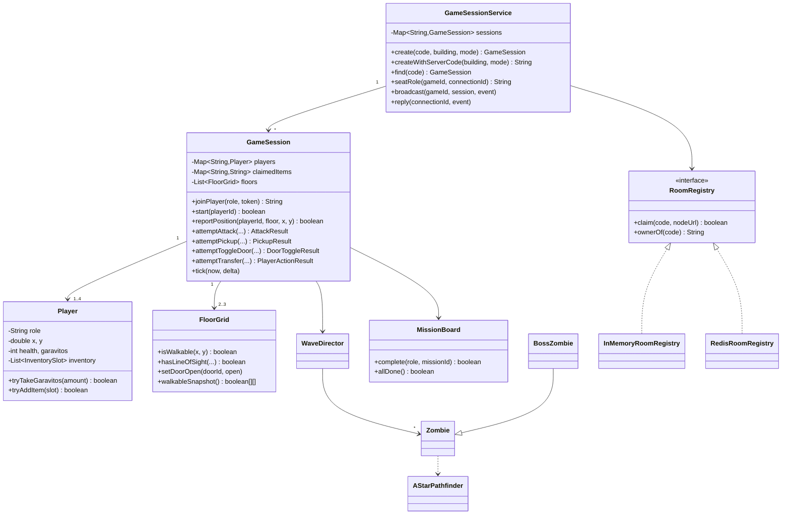
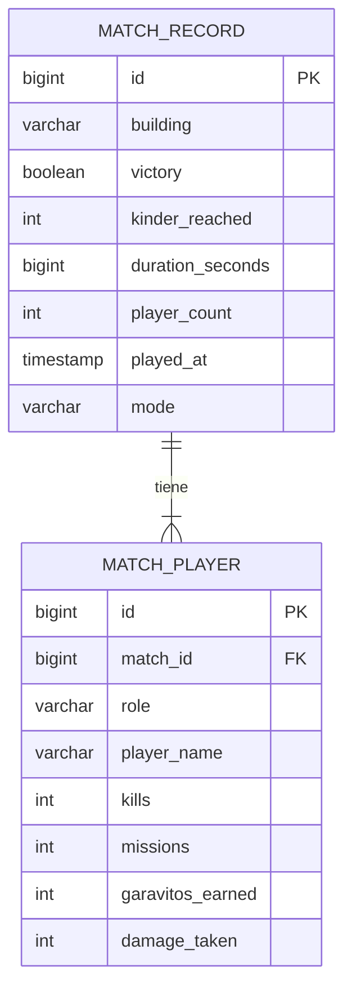
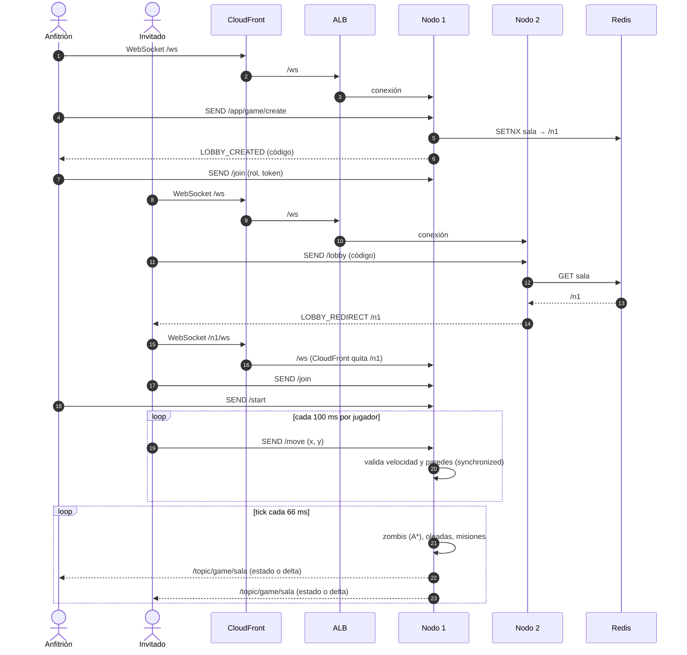
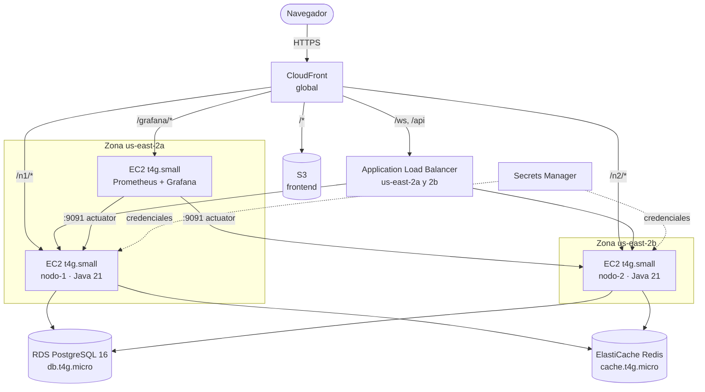
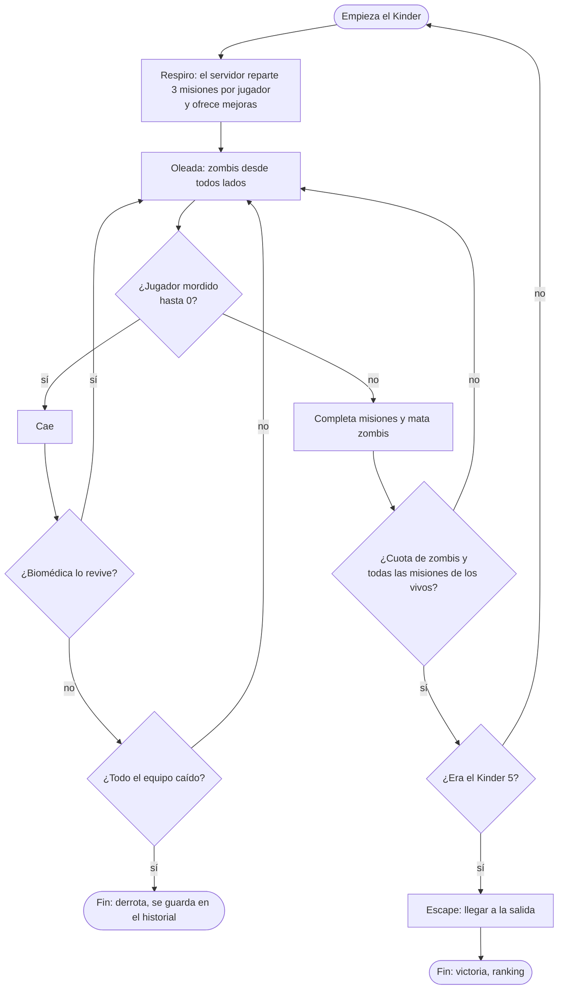

# Diagramas UML

Los diagramas están en Mermaid: GitHub los dibuja solos, y para el documento en LaTeX
se exportan con `npx @mermaid-js/mermaid-cli -i docs/DIAGRAMAS.md -o diagrama.png`
(o desde https://mermaid.live).

## 1. Contexto



## 2. Componentes

```mermaid
flowchart TB
  subgraph Frontend [Frontend React + Phaser]
    UI[Componentes React<br/>menús, HUD, minijuegos]
    ESC[MainScene Phaser<br/>mapa, jugadores, zombis]
    SYNC[gameSync / socketService<br/>STOMP sobre SockJS]
    UI --> SYNC
    ESC --> SYNC
  end
  subgraph Backend [Nodo backend Spring Boot]
    CTRL[GameController<br/>@MessageMapping]
    SEG[security: StompGuard, LimiteSalas,<br/>OrigenVerificado, ApiRateLimit]
    SVC[GameSessionService<br/>salas, tick, difusión]
    SES[GameSession<br/>reglas autoritativas]
    WAVE[WaveDirector, MissionBoard,<br/>AStarPathfinder, BossZombie]
    HIST[MatchHistoryService<br/>RankingController]
    REG[RoomRegistry<br/>InMemory / Redis]
    SEG --> CTRL --> SVC --> SES --> WAVE
    SVC --> REG
    SES --> HIST
  end
  SYNC -- /app/game/** --> SEG
  SVC -- /topic/game/sala --> SYNC
  HIST --> DB[(PostgreSQL)]
  REG --> R[(Redis)]
  PROM[Prometheus] -- /actuator/prometheus --> Backend
  GRAF[Grafana] --> PROM
```

## 3. Clases (núcleo del juego)



## 4. Entidad–Relación



Migraciones Flyway: `backend/src/main/resources/db/migration/V1..V4`. El estado de
las partidas en curso no está en la base: vive en la memoria del nodo.

## 5. Secuencia: crear sala, unirse y moverse



## 6. Despliegue (AWS, stack `OperacionGaravitoDistribuido`)



## 7. Actividades: un Kinder


