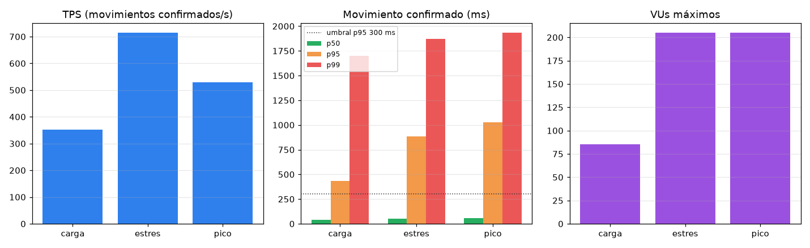
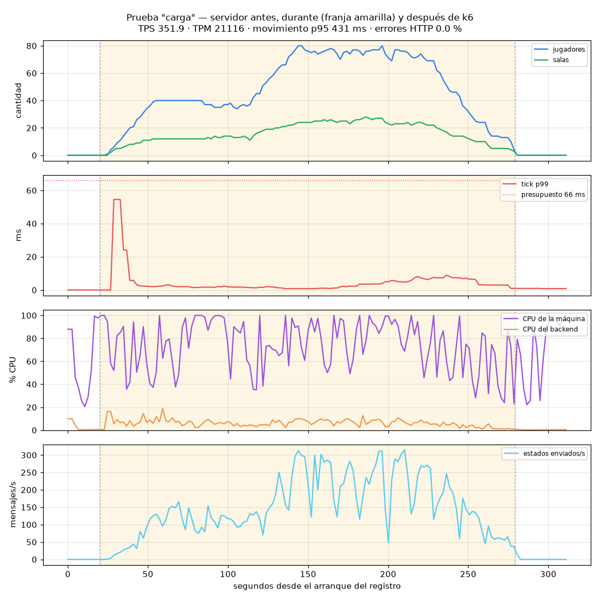
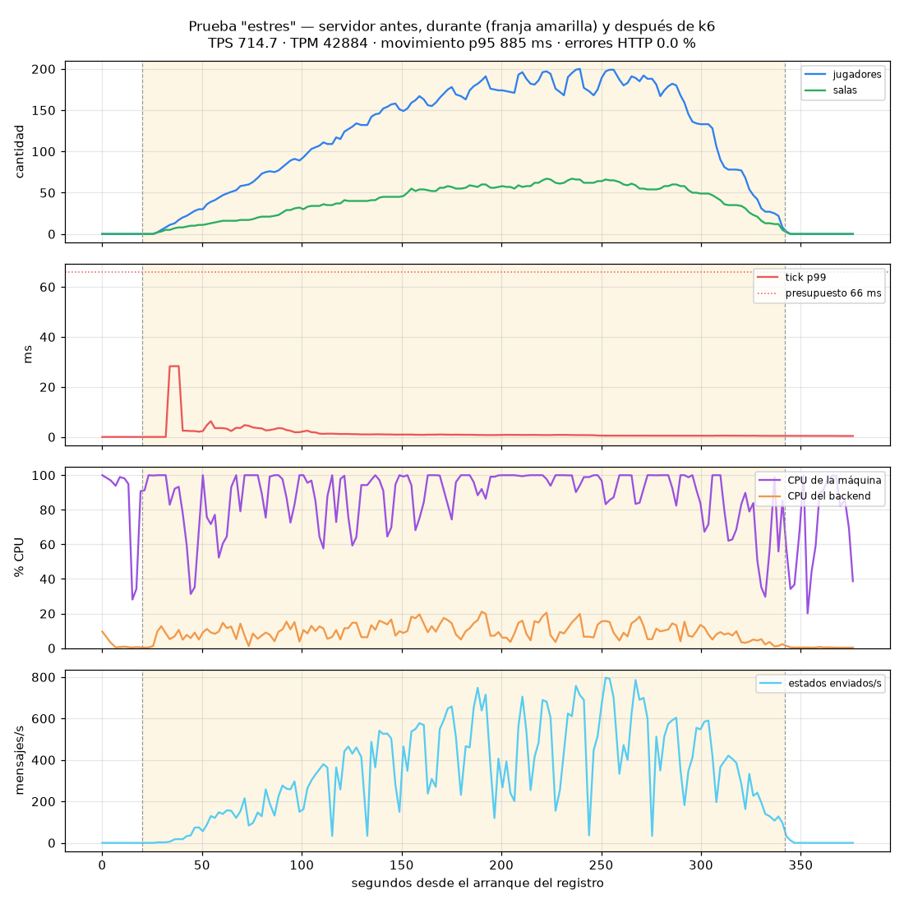
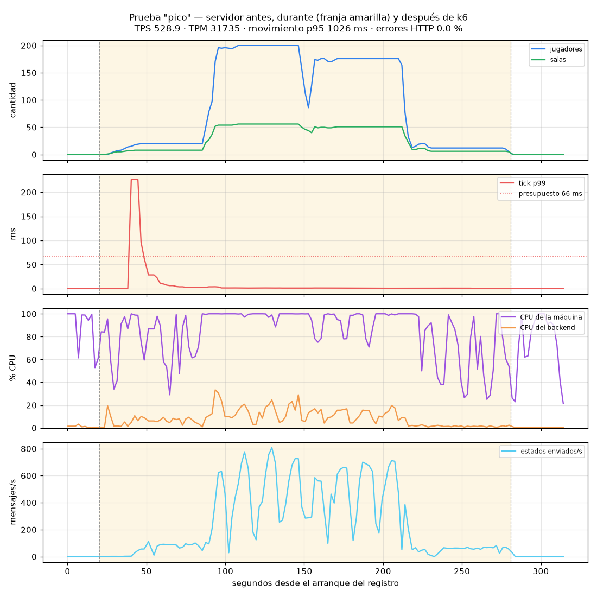

# Rendimiento: carga, estrés y picos con k6

Escenarios de calidad: [ER-1](ESCENARIOS_DE_CALIDAD.md#er-1--rendimiento-operación-esperada)
y [ER-2](ESCENARIOS_DE_CALIDAD.md#er-2--rendimiento-pico-brusco). Corrida del
**20-11-2026**, rama `release/entrega-final`.

## 1. Metodología

### Flujo objetivo (representativo del uso real)

Cada usuario virtual (VU) de k6 es **un jugador** que hace lo mismo que el navegador
(`k6/partidas.js`):

1. Abre el WebSocket (`/ws/websocket`, SockJS) y hace el `CONNECT` de STOMP.
2. Se suscribe al estado de su sala (`/topic/game/{sala}`) y a su cola privada.
3. Pide la sala (`/app/game/{sala}/lobby`) y se sienta en un rol (`/join`). Cada 4 VUs
   comparten sala (los 4 roles).
4. Juega: manda su posición 10 veces por segundo (`/move`) y ataca el 30 % de esas
   veces (`/attack`) durante 60 s; mide cuánto tarda en ver su movimiento en el
   estado del servidor y cada cuánto le llega el estado.
5. Sale (`/leave`) y vuelve a entrar a una sala nueva.

En paralelo, un escenario HTTP consulta `GET /api/ranking` 5 veces por segundo (la
pantalla de inicio).

| Endpoint | Tipo | Uso |
|---|---|---|
| `/ws` → `/app/game/{sala}/lobby`, `/join`, `/start`, `/move`, `/attack`, `/leave` | STOMP sobre WebSocket | Jugar |
| `/topic/game/{sala}` | STOMP (servidor → cliente) | Estado de la sala cada ~125 ms |
| `GET /api/ranking?building=` | REST | Ranking |

### Solicitud vs. transacción de negocio

- **Solicitud:** cada mensaje que manda el cliente (STOMP: `lobby`, `join`, `start`,
  `move`, `attack`, `leave`) o cada `GET /api/ranking`.
- **Transacción de negocio:** un **movimiento confirmado**: el jugador manda su
  posición y el servidor la valida (velocidad, paredes), la aplica y la devuelve en el
  estado de la sala. Es la operación que define si el juego "responde" en tiempo real.
  Se cuenta en la métrica `movimientos_confirmados` de k6.

**TPS** = transacciones / duración en segundos. **TPM** = transacciones / duración en
minutos. k6 los calcula solo al terminar (`handleSummary` en `k6/partidas.js`) y los
guarda en `docs/k6/resultados/<perfil>.json`.

### Perfiles (tres tipos de prueba)

| Perfil | Tipo | Forma | Duración |
|---|---|---|---|
| `carga` | Operación esperada | 0 → 40 → 80 jugadores, sostenido | ~4 min |
| `estres` | Incremento hasta el límite | 80 → 160 → 200 jugadores, sostenido 1 min | ~5 min |
| `pico` | Salto brusco y recuperación | 20 jugadores → **200 en 10 s** → 1 min → **20 en 10 s** → 1 min | ~4 min |

### Umbrales de aceptación (en `options.thresholds`)

| Umbral | Por qué |
|---|---|
| `ida_y_vuelta_movimiento_ms` p95 < 300 ms | Desde ~300 ms el jugador nota que su personaje responde tarde |
| `intervalo_estado_ms` p95 < 250 ms | El servidor emite cada ~125 ms: más del doble se ve a saltos |
| `http_req_duration{endpoint:ranking}` p95 < 300 ms | La API también debe responder |
| `http_req_failed` < 1 % | Tasa de errores |
| `entrada_exitosa` > 95 % | Capacidad: casi todos los jugadores logran entrar |

### Entorno de ejecución

- **Servidor y generador en el mismo portátil** (AMD Ryzen 5 5500U, 6 núcleos / 12
  hilos, 15 GB de RAM; ~4 GB libres durante la corrida), backend Spring Boot con H2 y
  perfiles `dev,carga` (los jugadores falsos eligen el código de su sala y salen de la
  misma IP, cosa que los límites de producción no dejarían).
- Antes de cada prueba se levanta un backend limpio y se registran 20 s de línea base;
  después, 30 s de recuperación (`k6/correr_pruebas.sh`).
- Métricas del servidor cada 2 s desde `/actuator/prometheus` (las mismas que lee
  Prometheus) con `k6/registrar_metricas.py`.

Para repetirlo:

```bash
cd backend && ./mvnw -B package -DskipTests && cd ..
bash k6/correr_pruebas.sh            # carga, estres y pico
pip install matplotlib && python k6/graficar.py
```

## 2. Resultados reales

| Medida | Carga | Estrés | Pico |
|---|---|---|---|
| Duración | 259 s | 322 s | 261 s |
| VUs máximos (jugadores + ranking) | 85 | 205 | 205 |
| **Transacciones** (movimientos confirmados) | 91 064 | 230 263 | 137 837 |
| **TPS** | **351,9** | **714,7** | **528,9** |
| **TPM** | **21 116** | **42 884** | **31 735** |
| Solicitudes/s (STOMP + HTTP) | 477,4 | 968,4 | 715,1 |
| Estados recibidos/s | 514 | 1 155 | 883 |
| Movimiento confirmado p50 / p95 / p99 | 41 / **431** / 1 703 ms | 50 / **885** / 1 870 ms | 59 / **1 026** / 1 934 ms |
| Intervalo de estado p50 / p95 / p99 | 50 / **196** / 931 ms | 39 / **265** / 1 365 ms | 32 / **314** / 1 458 ms |
| Ranking p95 | 942 ms | 1 407 ms | 865 ms |
| Errores HTTP | **0 %** | **0 %** | **0 %** |
| Entrada exitosa | **100 %** | **100 %** | **100 %** |
| Sesiones cortadas | 0 | 0 | 0 |
| Datos recibidos por k6 | 384 MB | 1,1 GB | 689 MB |

| Umbral | Carga | Estrés | Pico |
|---|---|---|---|
| Movimiento p95 < 300 ms | ❌ | ❌ | ❌ |
| Estado p95 < 250 ms | ✅ | ❌ | ❌ |
| Ranking p95 < 300 ms | ❌ | ❌ | ❌ |
| Errores HTTP < 1 % | ✅ | ✅ | ✅ |
| Entrada exitosa > 95 % | ✅ | ✅ | ✅ |

Archivos: `docs/k6/resultados/{carga,estres,pico}.json` (resumen con TPS/TPM),
`{perfil}.txt` (salida completa de k6), `{perfil}-servidor.csv` (métricas del servidor)
y `docs/k6/reporte-{perfil}.html` (gráficas de k6 en el tiempo, abrir en el navegador).



## 3. Correlación con el servidor (antes, durante, después)

La franja amarilla es el tiempo en que corrió k6; antes está la línea base y después
la recuperación.

### Carga


### Estrés


### Pico


| Métrica del servidor | Carga | Estrés | Pico |
|---|---|---|---|
| Jugadores máximos | 80 | 200 | 200 |
| Tick p99 máximo (presupuesto 66 ms) | 54,5 ms (arranque) | **28,3 ms** | 226 ms en el calentamiento de la JVM, luego < 5 ms |
| CPU del backend (máx.) | 19 % | 21 % | 33 % |
| **CPU de toda la máquina** (media con carga / máx.) | **74 % / 100 %** | **88 % / 100 %** | **84 % / 100 %** |
| Heap máximo | 116 MB | 136 MB | 137 MB |

**Qué pasó en el pico:** los jugadores suben de 20 a 200 en ~10 s (segundo ~85) y los
estados enviados pasan de ~100/s a ~800/s; el tick del servidor no se mueve (< 5 ms)
y la CPU del backend sube hasta 33 %. Las caídas cortas a ~90 jugadores en el segundo
~150 son los VUs que terminan su sesión de 60 s y vuelven a entrar (no son errores:
0 sesiones cortadas). Al bajar a 20 jugadores (segundo ~215) los mensajes vuelven
enseguida a ~70/s: **el servidor se recupera solo y sin errores**.

## 4. Análisis de cuellos de botella

1. **El cuello de botella de esta corrida es el generador, no el juego.** La CPU de la
   máquina estuvo entre 74 y 88 % de media y tocó 100 % (ya estaba alta en la línea
   base), mientras el backend usó como máximo 33 % y su tick quedó muy por debajo de
   su presupuesto (28 ms p99 con 200 jugadores). k6 parsea en JavaScript cada estado
   que recibe (hasta 1 155 por segundo, 3,3 MB/s) y compite con el backend por la CPU.
   Por eso las latencias p95 de esta corrida son mucho peores que las de la corrida
   del 29-10-2026 con la misma máquina más libre (movimiento p95 101 ms y estado p95
   133 ms con 200 jugadores, `docs/k6/README.md`).
2. **Las colas largas (p99 de 1,7–1,9 s)** coinciden con los momentos de CPU al 100 %:
   el sistema operativo deja de darle tiempo al hilo de red de k6 o al del backend.
3. **El ranking** (p95 0,9–1,4 s) consulta H2 en memoria en cada pedido que no está en
   la caché de 8 s; con la CPU saturada es lo primero que se nota. En producción usa
   PostgreSQL y la misma caché.
4. **La red es lo que más crece con los jugadores:** 1,1 GB recibidos en 5 minutos de
   estrés. Por eso el servidor manda estados "delta" (solo lo que cambió,
   `DeltaEncoder`).

**TPS máximo sostenible:** **714,7 TPS (42 884 TPM)** con 200 jugadores: 0 errores,
100 % de entradas, 0 sesiones cortadas y el tick del servidor en 28 ms p99 (43 % de su
presupuesto). **Punto de degradación:** en esta máquina compartida, la latencia de
movimiento supera los 300 ms de p95 desde la carga esperada (80 jugadores) por la
saturación de CPU del generador; el servidor en sí no mostró degradación (tick, heap y
errores estables) y se recuperó del pico en segundos.

## 5. Conclusiones y acciones de mejora

- El servidor soporta 200 jugadores concurrentes con 0 errores y se recupera solo de
  un pico de 10× en 10 s. Su capacidad real es mayor que lo que este generador alcanza
  a medir.
- **Acción 1 (metodología):** correr k6 en una máquina distinta al servidor. Con el
  despliegue distribuido en AWS (`infra/lib/distribuido-stack.ts`), k6 corre en el
  portátil y el backend en sus propias EC2 (`k6 run -e BASE_URL=https://<url>
  -e PERFIL=pico k6/partidas.js`; ver DISPONIBILIDAD.md).
- **Acción 2:** escalar horizontalmente (segundo nodo detrás del balanceador) cuando la
  CPU del backend pase de 70 % o el tick p99 de 40 ms (alertas de Grafana).
- **Acción 3:** reducir el tamaño del estado (más campos en delta, compresión
  permessage-deflate) para bajar los 3,3 MB/s de red.
- **Acción 4:** índices y caché más larga para el ranking si crece el historial.

La correlación con Grafana (paneles en vivo) está en [grafana/README.md](grafana/README.md)
y [k6/README.md](k6/README.md): con `-o experimental-prometheus-rw` k6 escribe sus
métricas en el mismo Prometheus que lee el backend.
