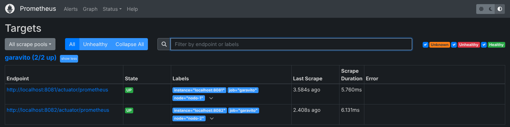
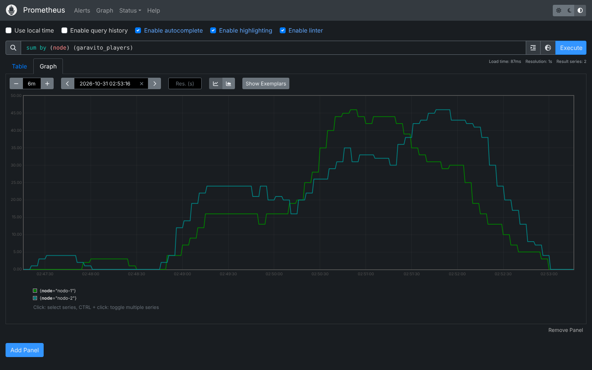
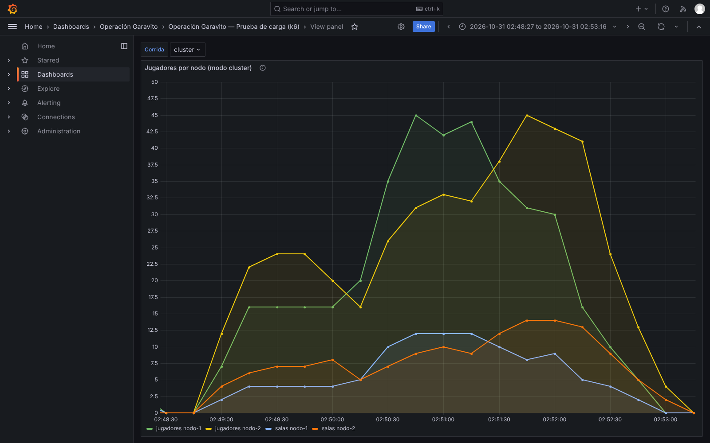
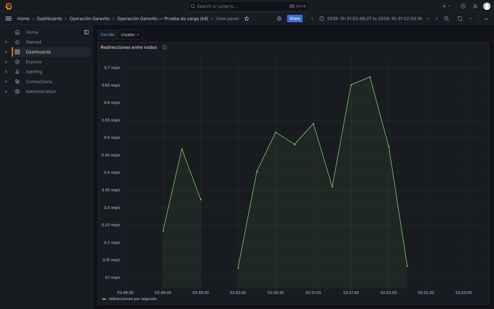
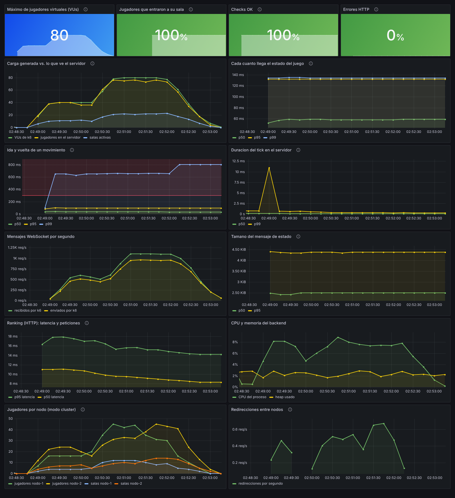
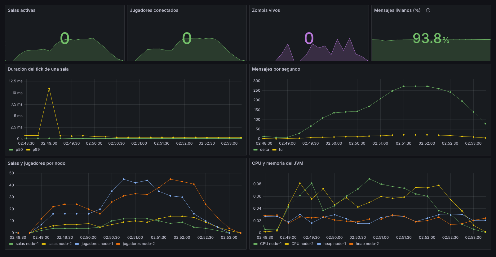
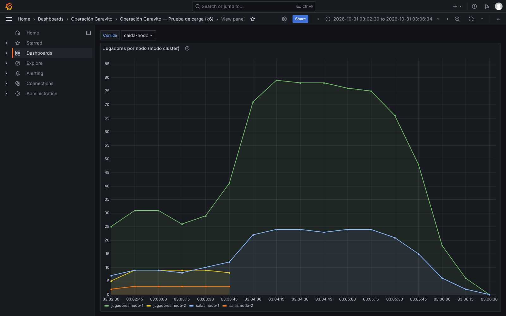
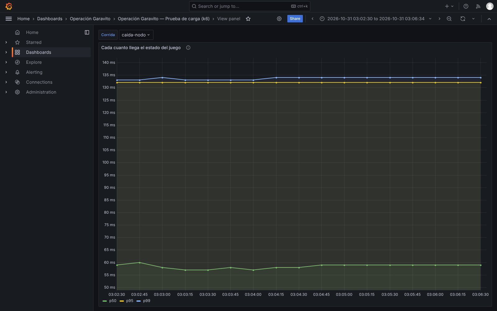

# Escalado horizontal — dos nodos detrás de un balanceador

Este documento muestra el juego corriendo en **dos nodos del backend detrás de un
balanceador**, con carga de k6 repartida entre ambos. Incluye además qué pasa cuando
**se cae un nodo** en plena prueba. Todo lo de aquí se midió el 31-10-2026; las
capturas y salidas son de esas corridas.

Con un solo comando se levanta todo:

```bash
docker compose -f docker-compose.cluster.yml up --build
```

| Servicio | Dirección |
|---|---|
| Balanceador (nginx), la entrada del juego | `http://localhost:8080` |
| Nodo 1 / Nodo 2 | `http://localhost:8081` / `http://localhost:8082` |
| Prometheus | `http://localhost:9090` |
| Grafana (admin / garavito) | `http://localhost:3000` |

El frontend se apunta al balanceador con `VITE_WS_URL=http://localhost:8080/ws`.

## 1. Arquitectura

```
                         ┌───────────────────────────┐
  navegadores / k6 ────▶ │ nginx :8080 (balanceador) │
                         └─────────┬─────────┬───────┘
                       reparte las │         │ conexiones nuevas
                                   ▼         ▼
                         ┌───────────┐   ┌───────────┐
                         │  nodo-1   │   │  nodo-2   │   cada sala vive en
                         │  salas    │   │  salas    │   la memoria de UN nodo
                         │  A, C, …  │   │  B, D, …  │
                         └─────┬─────┘   └─────┬─────┘
                               │   ┌───────┐   │
                               ├──▶│ Redis │◀──┤  garavito:room:<código> → URL del nodo dueño
                               │   └───────┘   │  (SET NX, caduca en 2 min si no se renueva)
                               │ ┌──────────┐  │
                               └▶│ Postgres │◀─┘  historial y ranking (compartido)
                                 └──────────┘
          Prometheus consulta los dos nodos (etiqueta node) ─▶ Grafana
```

**Cómo entra un jugador a una sala que está en el otro nodo:**

1. El balanceador manda la conexión a cualquiera de los dos nodos.
2. El jugador pide la sala (`/lobby`). Si ese nodo no la tiene, consulta Redis y, si
   el dueño es el otro, responde `LOBBY_REDIRECT` con la URL de ese nodo.
3. El cliente (el frontend en `gameSync.js`, y k6 igual) se reconecta **directamente**
   a ese nodo y entra.

Así cada partida se juega entera en un solo nodo, sin compartir estado de juego entre
máquinas: por eso el tick sigue siendo local y rápido. Redis solo guarda **dónde está**
cada sala.

**El balanceador** (`cluster/nginx.conf`) reparte las conexiones nuevas entre los
nodos. Además, las peticiones de una misma sesión de SockJS van siempre al mismo nodo,
para que funcionen también los transportes de respaldo de SockJS, no solo el
WebSocket.

## 2. Monitoreo de los dos nodos

Prometheus (`monitoring/prometheus.cluster.yml`) consulta cada nodo y les pone la
etiqueta `node`:





El tablero de k6 en Grafana tiene dos paneles para el clúster: **Jugadores por nodo**
y **Redirecciones entre nodos**.

## 3. Prueba: 80 jugadores repartidos en dos nodos

```bash
K6_PROMETHEUS_RW_SERVER_URL=http://localhost:9090/api/v1/write \
K6_PROMETHEUS_RW_TREND_STATS="p(50),p(95),p(99),avg,max" \
k6 run -o experimental-prometheus-rw --tag testid=cluster -e BASE_URL=http://localhost:8080 k6/partidas.js
```



*Las dos rampas de 40 y 80 jugadores se reparten entre `nodo-1` y `nodo-2`. Cada nodo
llegó a un máximo de 46 jugadores (13 y 14 salas). La suma nunca pasó de 81.*



*80 jugadores llegaron por el balanceador a un nodo que no tenía su sala y fueron
redirigidos al dueño. Todos entraron.*

| Umbral (k6) | Resultado | |
|---|---|---|
| Entrada exitosa > 95 % | **100 %** (210 de 210) | ✅ |
| Intervalo de estado p95 < 250 ms | **132 ms** | ✅ |
| Ida y vuelta del movimiento p95 < 300 ms | **97 ms** | ✅ |
| Ranking p95 < 300 ms (pasa por el balanceador) | **13,9 ms** | ✅ |
| Errores HTTP < 1 % | **0 %** | ✅ |

Tablero completo de la corrida:



*El pico de ~11 ms en "Duración del tick" al principio es el calentamiento del JVM
(los nodos acababan de arrancar); después se queda por debajo de 1 ms.*



Salida completa de k6: [`k6-cluster.txt`](k6-cluster.txt).

## 4. Experimento: se cae un nodo en plena prueba

Con la misma prueba corriendo, a los 100 segundos se mató el proceso de `nodo-2`
(`kill -9`, sin apagado ordenado). En ese momento `nodo-1` tenía 37 jugadores y
`nodo-2` tenía 8.



*A las 03:03:45 desaparece `nodo-2` (curvas amarilla y naranja). Desde ahí el
balanceador manda todo a `nodo-1`, que sube hasta 79 jugadores.*



*El intervalo entre estados no se movió: p95 = 132 ms antes y después de la caída.*

| Qué pasó | Resultado |
|---|---|
| Partidas que estaban en `nodo-2` | **Se perdieron**: 12 conexiones cortadas (`sesiones_cortadas`). |
| Conexiones fallidas justo después de la caída | **2** de 221 (`WebSocket abierto` 99 %). |
| Jugadores que entraron después | **207 de 207** (100 %), todos en `nodo-1`. |
| Latencia para los que siguieron jugando | Igual: estado p95 132 ms, movimiento p95 99 ms. |

Salida completa de k6: [`k6-caida-nodo.txt`](k6-caida-nodo.txt).

**Qué significa:**

- **El servicio sobrevive a la caída de un nodo:** la gente puede seguir entrando y
  jugando sin que nadie haga nada.
- **Las partidas que estaban en el nodo caído se pierden**, porque el estado del
  juego vive en la memoria de ese nodo. Es una decisión de diseño: guardar el estado
  fuera (por ejemplo, en Redis) en cada tick haría el juego mucho más lento. Para un
  juego de partidas cortas, perder las partidas de un nodo es aceptable.
- **Lo que mejoraríamos:** si alguien pide una sala del nodo caído durante los
  2 minutos que tarda en caducar su registro en Redis, lo redirigen a un nodo muerto.
  La solución es que cada nodo publique un *heartbeat* en Redis y que los demás
  ignoren las salas de nodos sin heartbeat.

## 5. Cómo reproducir la demo en la presentación

1. `docker compose -f docker-compose.cluster.yml up --build` y esperar a que
   `http://localhost:8080/actuator/health` responda `UP`.
2. Abrir Grafana → tablero **Prueba de carga (k6)** y elegir el rango
   *Last 15 minutes*.
3. Lanzar k6 contra el balanceador (comando de la sección 3) y mostrar cómo se llenan
   las dos curvas de **Jugadores por nodo**.
4. Durante la prueba: `docker compose -f docker-compose.cluster.yml stop node2`. La
   curva de `nodo-2` se corta y `nodo-1` absorbe a los nuevos jugadores.

> **Nota sobre cómo se midió:** las mediciones de las secciones 3 y 4 se hicieron con
> los dos nodos corriendo como procesos Java (`SPRING_PROFILES_ACTIVE=cluster`, puertos
> 8081 y 8082) y el resto en Docker, cambiando solo los nombres de host
> (`node1`/`node2` por `localhost`).
>
> Después se validó el `docker compose -f docker-compose.cluster.yml up` completo,
> con los nombres de servicio reales: el balanceador alterna entre `nodo-1` y
> `nodo-2`, Prometheus los lee a los dos y Grafana carga tableros y alertas. Con k6
> corriendo, `docker compose ... stop node2` disparó "Backend caído" a los 30 s. Las
> peticiones HTTP por el balanceador siguieron respondiendo 200 y los 492 jugadores
> que terminaron su sesión habían entrado. Hubo 6 conexiones fallidas: jugadores
> redirigidos al nodo caído antes de que caducara su registro en Redis. Además, de
> vez en cuando una petición tarda ~2 s: nginx intenta el nodo apagado, espera el
> `proxy_connect_timeout` y pasa al otro.
>
> Lo único que no se pudo probar en la máquina de pruebas es la etapa de compilación
> del `backend/Dockerfile`, porque Docker Hub limitó la descarga de la imagen del JRE.
> Para la validación se usó una imagen equivalente con el jar ya compilado. Conviene
> correr `up --build` una vez en el equipo de la presentación.
