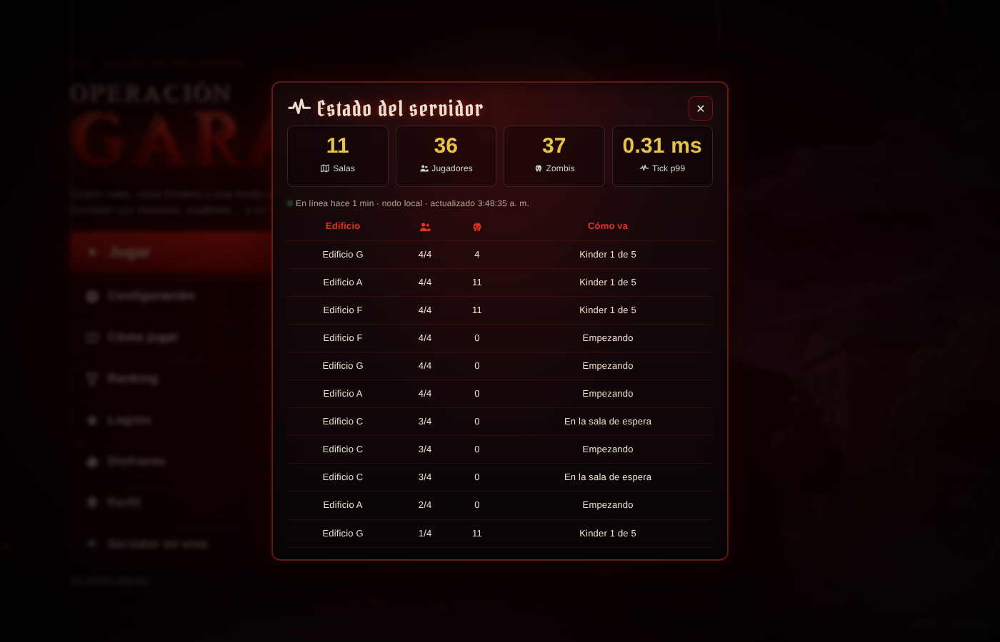
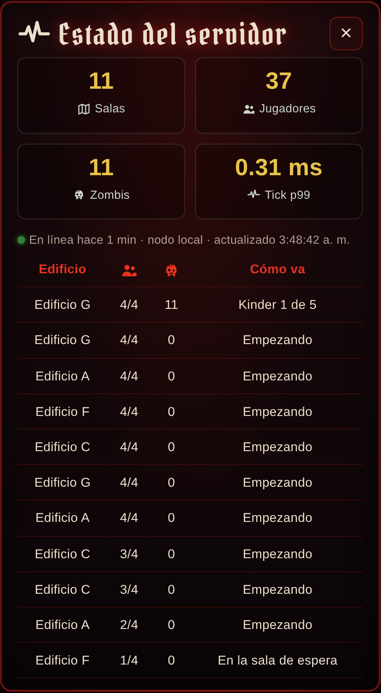

# Servidor en vivo — página de estado del juego

Desde el menú principal, el botón **Servidor en vivo** abre un panel con lo que está
pasando en el servidor en este momento. Se actualiza solo cada 3 segundos.



*Captura real del 31-10-2026 con 40 jugadores simulados por k6 (`k6 run k6/partidas.js`).*

| Qué muestra | De dónde sale |
|---|---|
| Salas, jugadores y zombis | Las salas abiertas en la memoria del nodo (`GameSessionService`). |
| Tick p99 | El mismo `Timer` de Micrometer que lee Prometheus (`garavito_tick_seconds`). |
| En línea hace… / nodo | Tiempo encendido del JVM y la URL pública del nodo (`local` con un solo nodo). |
| Tabla de partidas | Edificio, jugadores, zombis vivos y en qué Kinder va cada sala; las más llenas primero. |

## El endpoint

```
GET /api/estado
```

```json
{
  "nodo": "local",
  "segundosEncendido": 74,
  "salas": 11,
  "jugadores": 36,
  "zombis": 37,
  "tickP99Ms": 0.31,
  "partidas": [
    { "edificio": "G", "jugadores": 4, "zombis": 4, "enCurso": true, "kinder": 1, "kinders": 5, "jefe": false }
  ]
}
```

- **No incluye los códigos de sala.** Con un código cualquiera podría entrar a una
  partida ajena, así que el endpoint solo cuenta qué hay.
- El resumen se arma con el mismo candado por sala que usa el estado del juego, para
  no leer una sala a medio actualizar.
- Tiene el mismo CORS que `/api/ranking` (`WS_ALLOWED_ORIGINS`).
- Con varios nodos ([`docs/escalado`](../escalado/README.md)), cada nodo responde por
  lo suyo y el campo `nodo` dice cuál contestó. La vista de todo el clúster está en
  Grafana.

## Diferencia con Grafana

Grafana ([`docs/grafana`](../grafana/README.md)) es para el equipo: historia,
percentiles y alertas. Esta página es para los **jugadores**: les muestra en el juego
que hay gente jugando y que el servidor anda bien.

## En celular



En pantallas angostas las cuatro cifras pasan a dos columnas; la prueba no encontró
desbordes horizontales.

## Pruebas

- `backend/.../EstadoTest.java`: cuenta salas y jugadores, ordena por llenado, no
  filtra los códigos y reporta el tick cuando hay métricas.
- `frontend/e2e/estado.spec.js`: un jugador arranca una partida en el Edificio G y,
  desde otro navegador, el panel la muestra con `1/4` jugadores.
