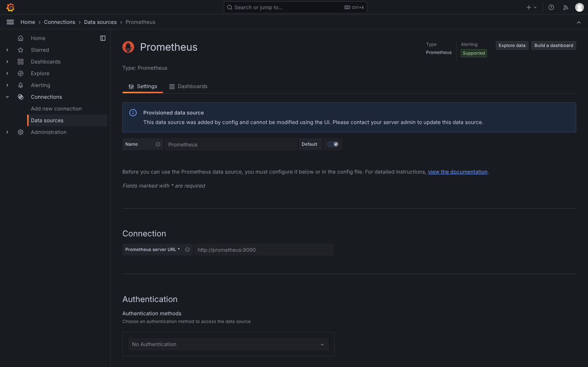
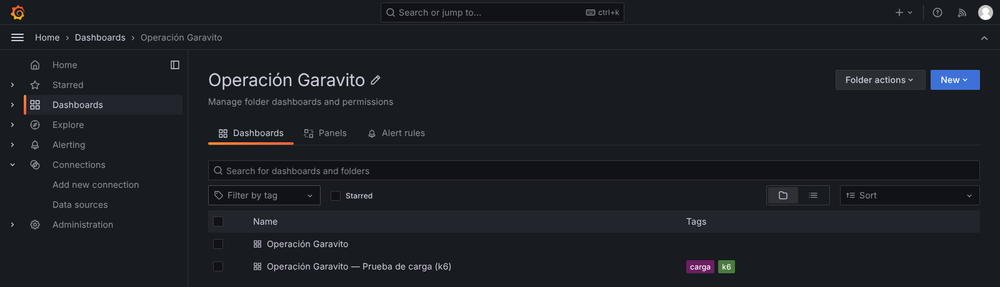
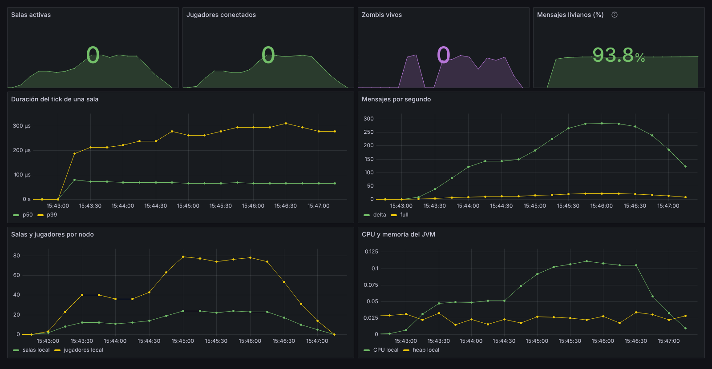
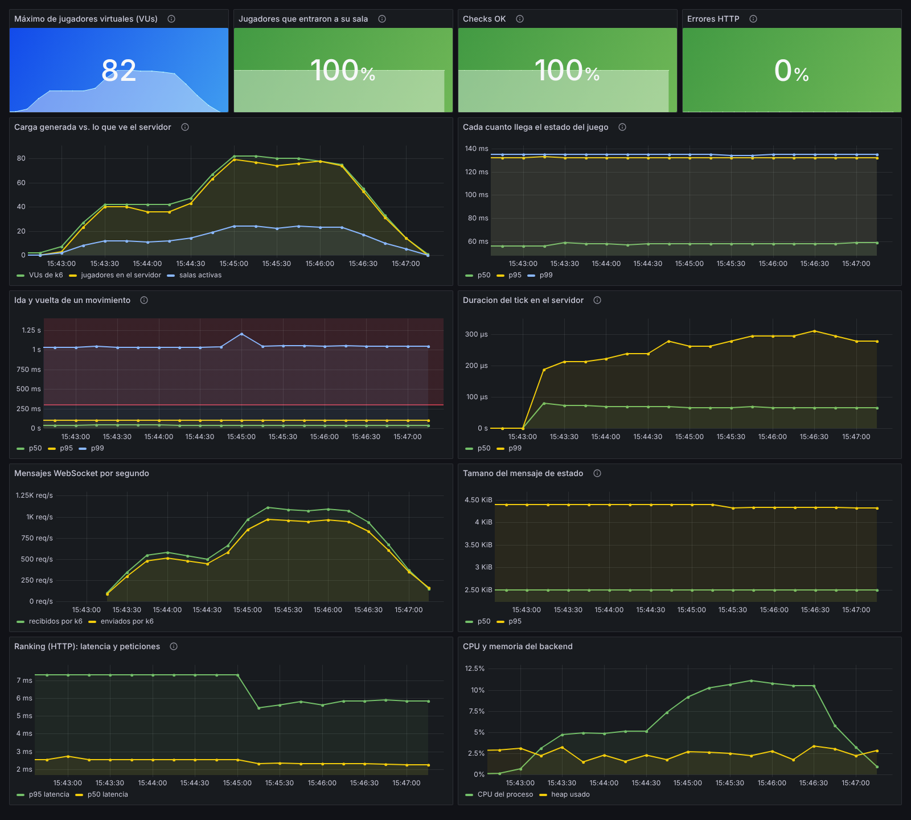
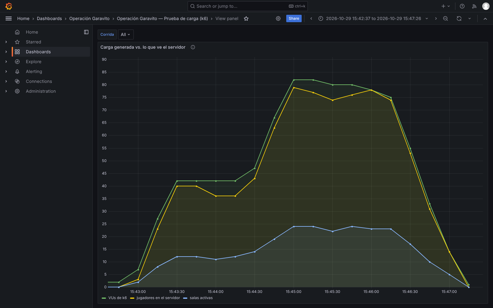
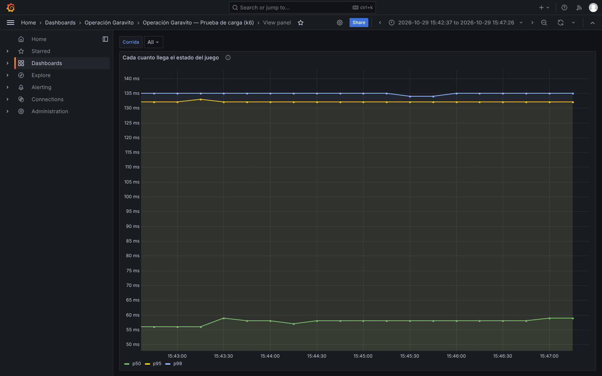
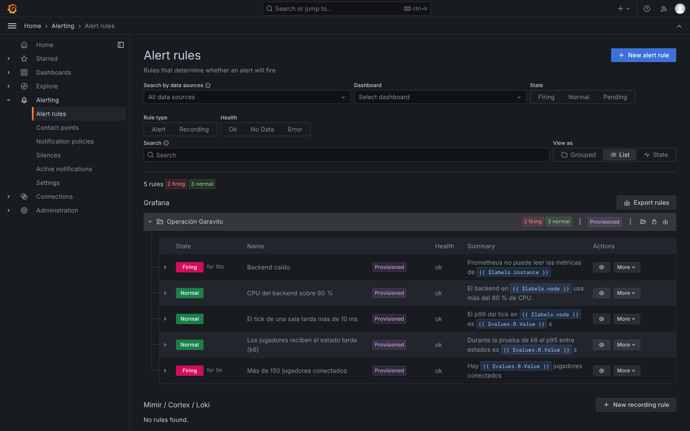
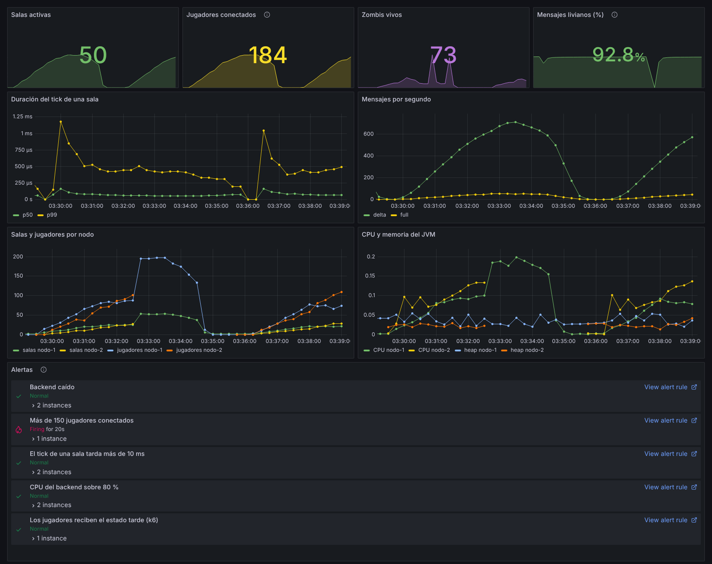
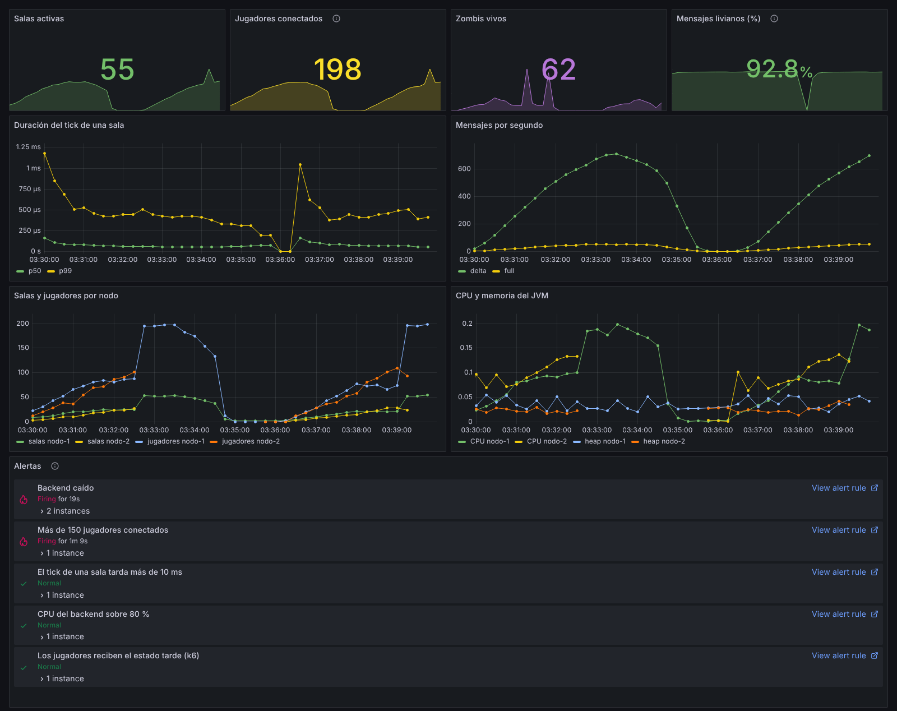

# Grafana — tableros de monitoreo

Grafana dibuja lo que guarda Prometheus (ver [`docs/prometheus`](../prometheus/README.md)).
El proyecto trae **dos tableros ya configurados** que se cargan solos al levantar
Grafana, sin hacer clic en nada:

| Tablero | Para qué | Archivo |
|---|---|---|
| **Operación Garavito** | El servidor en vivo: salas, jugadores, zombis, tick, mensajes, CPU y memoria. | `monitoring/grafana/dashboards/garavito.json` |
| **Operación Garavito — Prueba de carga (k6)** | Una prueba de k6 junto a lo que ve el servidor en ese momento. | `monitoring/grafana/dashboards/k6.json` |

Las capturas son de una corrida real del perfil `carga` de k6 (hasta 80 jugadores en
20 salas) del 29-10-2026. El backend, Prometheus, Grafana y k6 corrieron en la misma
máquina: Linux, 4 núcleos, 16 GB y JDK 21.

## 1. Cómo levantarlo

```bash
# Backend en el puerto 8080
cd backend && ./mvnw spring-boot:run -Dspring-boot.run.profiles=dev
```

```bash
# Prometheus (:9090) + Grafana (:3000)
docker compose -f monitoring/docker-compose.yml up -d
```

Abrir `http://localhost:3000`. Para mirar no hace falta entrar: el acceso anónimo está
habilitado en modo lectura. Para editar, el usuario es `admin` y la contraseña
`garavito`.

## 2. Configuración como código (provisioning)

Nada se configura a mano en la interfaz. Grafana lee al arrancar los archivos de
`monitoring/grafana/`, que el `docker-compose.yml` monta en el contenedor:

```
monitoring/grafana/
├── provisioning/
│   ├── datasources/prometheus.yml   ← fuente de datos "Prometheus" (http://prometheus:9090)
│   ├── dashboards/garavito.yml      ← "carga los JSON de /var/lib/grafana/dashboards"
│   └── alerting/reglas.yml          ← reglas de alerta (sección 6)
└── dashboards/
    ├── garavito.json                ← tablero del servidor
    └── k6.json                      ← tablero de la prueba de carga
```

`provisioning/datasources/prometheus.yml`:

```yaml
apiVersion: 1
datasources:
  - name: Prometheus
    uid: prometheus          # los paneles la referencian por este uid
    type: prometheus
    access: proxy            # el navegador le pide a Grafana y Grafana a Prometheus
    url: http://prometheus:9090   # nombre del servicio en docker compose
    isDefault: true
```

Con esto la fuente de datos aparece marcada como *provisioned*: no se puede romper
desde la interfaz.



Los tableros quedan en la carpeta **Operación Garavito**:



Las ventajas para el equipo: los tableros viven en Git, se revisan en los PR como
cualquier código y cualquiera los tiene iguales con un `docker compose up`. Si alguien
mejora un tablero en la interfaz, lo exporta (Share → Export → JSON) y reemplaza el
archivo.

## 3. Tablero "Operación Garavito" (servidor)



*Corrida `carga`. Los cuatro indicadores de arriba muestran el **valor actual** (aquí 0,
porque la ventana termina después de la prueba) y, de fondo, cómo evolucionó. En vivo
muestran las salas, jugadores y zombis del momento.*

| Panel | Consulta | Cómo leerlo |
|---|---|---|
| Salas activas | `sum(garavito_rooms)` | Salas abiertas ahora. |
| Jugadores conectados | `sum(garavito_players)` | Debe seguir a la carga; si se queda abajo, la gente no está entrando. |
| Zombis vivos | `sum(garavito_zombies)` | Lo que tiene que simular el servidor en cada tick. |
| Mensajes livianos (%) | `100 * delta / total` | Porcentaje de estados enviados como delta. Verde desde el 80 %: en la prueba fue ~93 %. |
| Duración del tick de una sala | `garavito_tick_seconds` p50 y p99 | El tick se repite cada 66 ms. En la prueba el p99 no pasó de ~0,4 ms. |
| Mensajes por segundo | `rate(garavito_messages_total[1m])` por `kind` | Crece con los jugadores. Casi todo es `delta`. |
| Salas y jugadores por nodo | `garavito_rooms`, `garavito_players` por `node` | Con varios nodos, muestra si la carga se reparte. |
| CPU y memoria del JVM | `process_cpu_usage`, heap usado / máximo | En la prueba, CPU ≤ 12 % y heap ≈ 3 %. |
| Alertas | reglas de `alerting/reglas.yml` | Estado de cada alerta, las disparadas primero (sección 6). |

## 4. Tablero "Prueba de carga (k6)"

Junta en una sola pantalla lo que **mide k6 desde el cliente** y lo que **reporta el
servidor**, para ver causa y efecto. El selector **Corrida** de arriba filtra por la
etiqueta `testid` de k6, así que se pueden comparar corridas distintas.



| Panel | De dónde sale | Qué buscar |
|---|---|---|
| Máximo de jugadores virtuales | k6 (`k6_vus`) | El pico de la prueba (82 incluye los VUs del escenario de ranking). |
| Jugadores que entraron a su sala | k6 (`entrada_exitosa`) | Umbral ≥ 95 %. Dio 100 %: 212 de 212 sesiones. |
| Checks OK | k6 (`checks`) | WebSocket abierto (101) y ranking 200. |
| Errores HTTP | k6 (`http_req_failed`) | Umbral < 1 %. Dio 0 %. |
| Carga generada vs. lo que ve el servidor | k6 + backend | Las curvas de VUs y de jugadores en el servidor deben ir juntas. |
| Cada cuánto llega el estado del juego | k6 (`intervalo_estado_ms`) | Umbral p95 < 250 ms (línea roja). Dio p95 = 132 ms. |
| Ida y vuelta de un movimiento | k6 (`ida_y_vuelta_movimiento_ms`) | Umbral p95 < 300 ms. Dio p95 = 99 ms. |
| Duración del tick en el servidor | backend | Confirma que el servidor no se esfuerza mientras sube la carga. |
| Mensajes WebSocket por segundo | k6 | Tráfico que recibe y envía el generador. |
| Tamaño del mensaje de estado | k6 | p50 ≈ 2,5 KB y p95 ≈ 4,4 KB. |
| Ranking (HTTP) | k6 (`http_req_duration`) | Umbral p95 < 300 ms. Dio p95 ≈ 5 ms. |
| CPU y memoria del backend | backend | Recursos del servidor durante la prueba. |

### Paneles en detalle

**Carga vs. servidor.** Los jugadores que reporta el backend (amarillo) siguen a los VUs
de k6 (verde) en las dos rampas, 40 y 80. Las salas (azul) llegan a ~24: son las 20
llenas más las que se están cerrando mientras los jugadores cambian de ronda.



**Intervalo entre estados.** El p95 y el p99 se quedan planos en ~132 ms con 40 y con
80 jugadores, muy lejos de la línea roja (250 ms). El servidor emite estado cada
125 ms y, con más jugadores, no se atrasa.



## 5. Qué conclusiones sacamos

- Con 80 jugadores simultáneos el servidor está desocupado: el tick p99 es menor a
  0,5 ms (de 66 ms disponibles) y el CPU ronda el 11 %.
- Lo que siente el jugador también está bien: el estado llega cada ~125 ms y su
  movimiento se refleja en menos de 100 ms el 95 % de las veces.
- La prueba de estrés, hasta 200 jugadores, y dónde empieza a degradarse están en
  [`docs/k6`](../k6/README.md).

## 6. Alertas

Los tableros sirven si alguien los está mirando. Las **alertas** avisan solas cuando
algo se sale de lo normal. Se definen en
`monitoring/grafana/provisioning/alerting/reglas.yml` y se cargan al arrancar Grafana,
igual que los tableros. Quedan en **Alerting → Alert rules**, carpeta *Operación
Garavito*.

| Alerta | Consulta | Se dispara si… | Durante | Severidad |
|---|---|---|---|---|
| Backend caído | `up{job="garavito"}` | Prometheus no puede leer un nodo (`up` < 1) | 15 s | crítica |
| Más de 150 jugadores conectados | `sum(garavito_players)` | > 150 | 30 s | aviso |
| El tick de una sala tarda más de 10 ms | `max by (node) (garavito_tick_seconds{quantile="0.99"})` | > 0,010 s | 30 s | aviso |
| CPU del backend sobre 80 % | `max by (node) (process_cpu_usage)` | > 0,8 | 1 min | aviso |
| Los jugadores reciben el estado tarde (k6) | `max(k6_intervalo_estado_ms_p95)` | > 0,25 s (el umbral de k6) | 30 s | aviso |

**Por qué estos umbrales:**
- **150 jugadores:** con k6 medimos que una máquina atiende 200 sin degradarse
  ([`docs/k6`](../k6/README.md)). A 150 conviene preparar otro nodo.
- **Tick de 10 ms:** el tick corre cada 66 ms y normalmente tarda menos de 1 ms, así
  que 10 ms ya es una señal clara de saturación.
- **"Durante":** evita alertas por picos de unos segundos. Mientras la condición se
  cumple pero no ha pasado ese tiempo, la alerta queda en *Pending*.

Las reglas que miran un nodo (`by (node)` o por `instance`) generan una instancia de
alerta por nodo: si se cae `nodo-2`, la alerta dice cuál fue.

El tablero del servidor tiene ahora un panel **Alertas** que las muestra con su
estado, las disparadas primero.

### Prueba en vivo

Para comprobar que se disparan de verdad, se corrió la prueba `estres` de k6
(200 jugadores) contra el modo de dos nodos ([`docs/escalado`](../escalado/README.md))
el 31-10-2026. Con la alerta de capacidad ya disparada, se apagó `nodo-2` con
`kill -9`:

| Hora (UTC) | Qué pasó |
|---|---|
| 03:36:12 | Empieza k6. |
| 03:38:53 | **Se dispara "Más de 150 jugadores conectados"**: superó 150 y se mantuvo 30 s. |
| 03:39:12 | Se apaga `nodo-2`. |
| 03:39:42 | **Se dispara "Backend caído"** para `nodo-2` (15 s de espera más el intervalo de evaluación de 10 s). |
| 03:41:35 | Termina k6: las 650 sesiones que llegaron a terminar entraron a su sala; 92 se cortaron por la caída. |



*Alerting → Alert rules durante la prueba: "Backend caído" y "Más de 150 jugadores"
en Firing; las otras tres en Normal.*



*Momento en que se dispara la alerta de capacidad: 184 jugadores (el indicador
"Jugadores conectados" ya está en amarillo).*



*30 s después de apagar `nodo-2`: las dos alertas disparadas. En "Salas y jugadores
por nodo" se ve cómo se cortan las curvas de `nodo-2` y `nodo-1` absorbe la carga.*

**Cómo repetirlo en la presentación:** con el modo de dos nodos levantado, lanzar
`k6 run -e PERFIL=estres -e BASE_URL=http://localhost:8080 k6/partidas.js`. Cuando se
dispare la alerta de capacidad (unos 2,5 min), correr
`docker compose -f docker-compose.cluster.yml stop node2`. Con un solo nodo, la
alerta "Backend caído" se prueba simplemente deteniendo el backend.

**Notificaciones:** las alertas se ven en Grafana pero no se envían a ningún lado,
porque no hay un *contact point* configurado. Para recibirlas por correo, Slack o
Discord se agrega uno en Alerting → Contact points; las reglas no cambian.

## 7. Problemas comunes

| Síntoma | Solución |
|---|---|
| Paneles con *No data* | En Prometheus → Targets el backend debe estar UP. Ajustar el rango de tiempo (arriba a la derecha). |
| El tablero de k6 está vacío | k6 se corrió sin `-o experimental-prometheus-rw` (ver `docs/k6`). |
| Cambié un JSON y no se ve | Grafana relee los archivos cada pocos segundos; si no, `docker compose -f monitoring/docker-compose.yml restart grafana`. |
| Una alerta no aparece | Revisar `docker compose logs grafana`: un error en `reglas.yml` sale como `provisioning.alerting`. |
| No puedo editar un panel | Entrar como `admin` / `garavito`. Los cambios hechos en la interfaz a un tablero provisionado no se guardan en el archivo: hay que exportar el JSON. |
