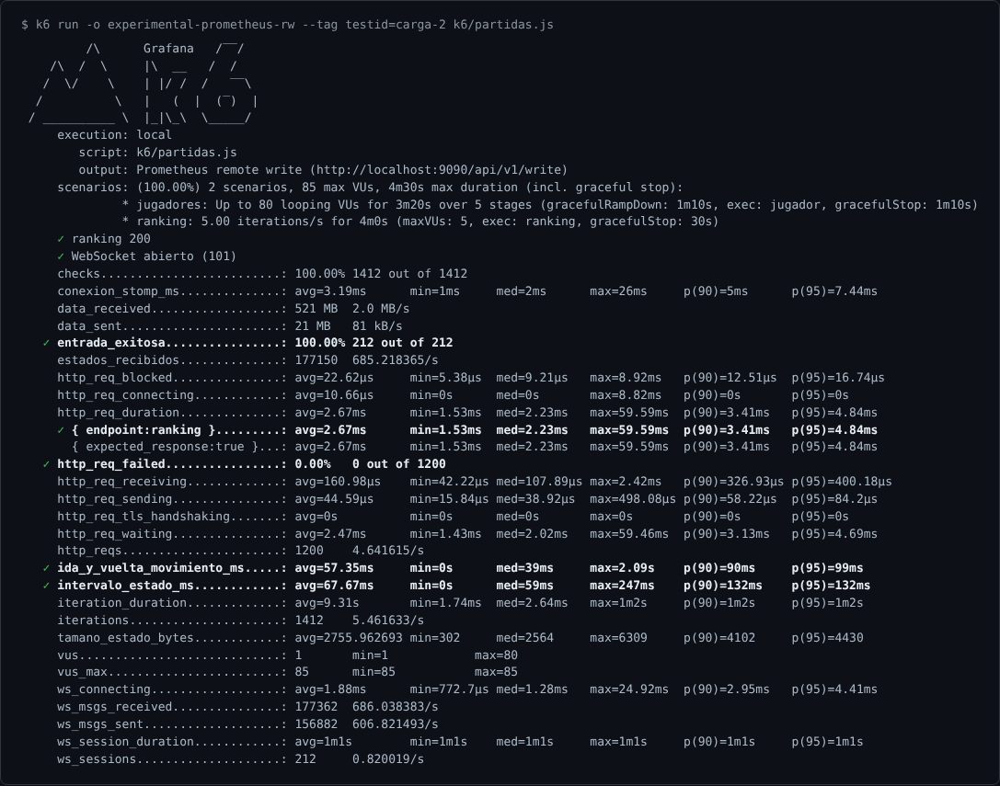
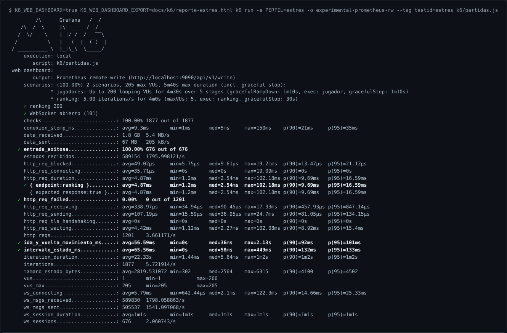
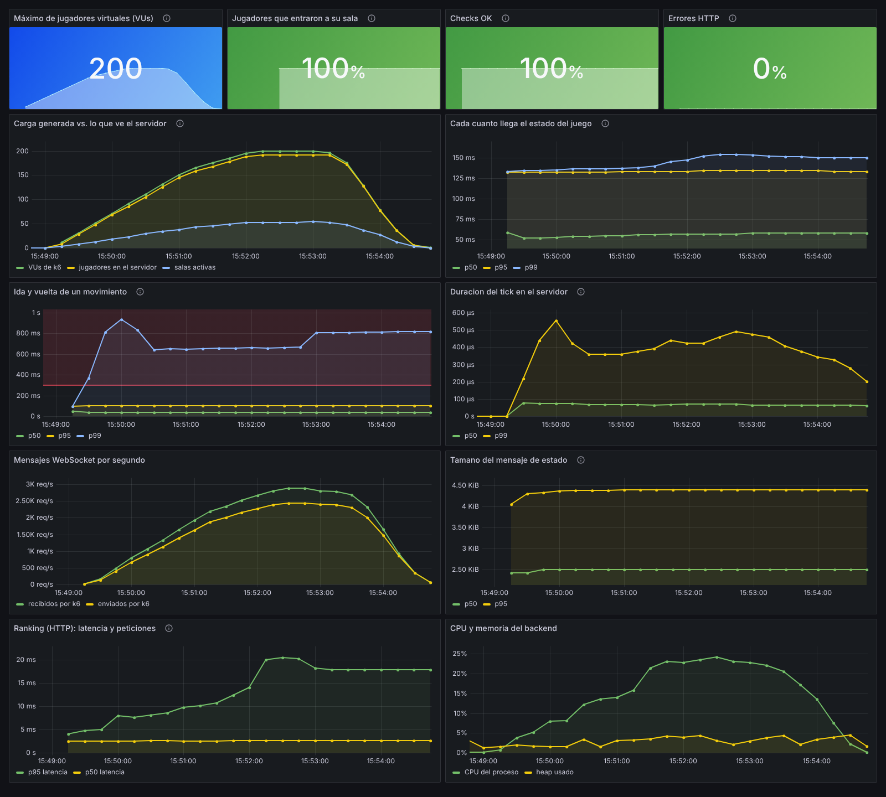
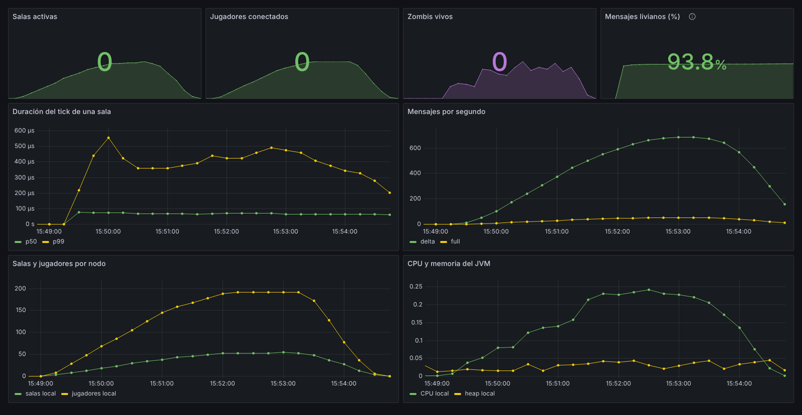
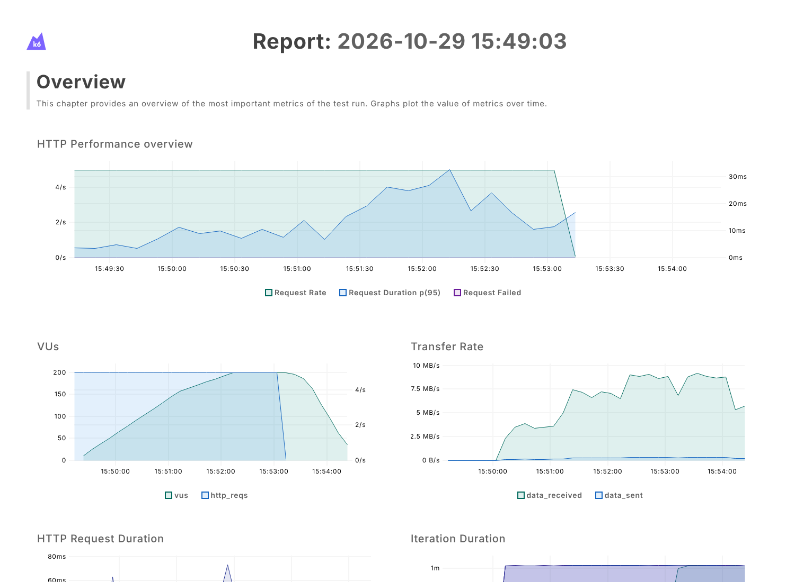
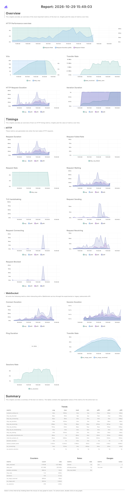

# k6 — pruebas de carga

[k6](https://k6.io) simula muchos jugadores al tiempo y mide si el juego sigue
respondiendo bien. El script está en [`k6/partidas.js`](../../k6/partidas.js).

Mientras corre, k6 envía sus métricas a Prometheus. Así, en Grafana se ve la carga que
generó k6 junto con lo que reportó el servidor en ese mismo momento (ver
[`docs/prometheus`](../prometheus/README.md) y [`docs/grafana`](../grafana/README.md)).

## 1. Qué simula el script

El juego no es una página web común: casi todo pasa por **WebSocket + STOMP**. Por eso
el script no se limita a pedir URLs, sino que se comporta como el frontend:

```
VU (jugador virtual)
 ├─ abre ws://<backend>/ws/websocket y manda CONNECT (STOMP)
 ├─ se suscribe a /topic/game/<sala>
 ├─ /app/game/<sala>/lobby  → crea la sala, o entra a la existente si ya la creó otro
 ├─ /app/game/<sala>/join   → toma su rol (SEGURIDAD, SALUD, ECONOMIA o INFRAESTRUCTURA)
 ├─ /app/game/<sala>/start  → cuando están los 4, o a los 15 s si falta alguno
 ├─ cada 100 ms: /move (camina por el vestíbulo) y, a veces, /attack
 └─ a los 60 s: /leave, cierra la conexión y vuelve a empezar en una sala nueva
```

- **Cada 4 VUs forman una sala**: los VUs 1 a 4 van a la sala 0, del 5 al 8 a la 1, etc.
- Los jugadores caminan a una velocidad que el servidor acepta, así que no los corrige
  por moverse demasiado rápido. El script cuenta las correcciones que haya en la métrica
  `correcciones_de_posicion`.
- Un segundo escenario, `ranking`, consulta `GET /api/ranking` cinco veces por segundo,
  como quien mira el ranking en la pantalla de inicio.

## 2. Qué mide

Además de las métricas estándar de k6 (`ws_*`, `http_*`, `checks`), el script define
las suyas:

| Métrica | Tipo | Qué es |
|---|---|---|
| `entrada_exitosa` | rate | De las sesiones que terminaron, cuántas lograron sentarse en su sala. |
| `intervalo_estado_ms` | trend | Tiempo entre dos estados del juego seguidos. El servidor emite uno cada 125 ms. |
| `ida_y_vuelta_movimiento_ms` | trend | Desde que el jugador manda su posición hasta que la ve en el estado del servidor. Es la latencia que siente el jugador. |
| `conexion_stomp_ms` | trend | Desde que abre el WebSocket hasta que STOMP responde `CONNECTED`. |
| `tamano_estado_bytes` | trend | Tamaño de cada mensaje de estado. |
| `estados_recibidos` | counter | Estados del juego recibidos. |
| `correcciones_de_posicion` | counter | Veces que el servidor rechazó un movimiento. |
| `entrada_rechazada{motivo}` | counter | Rechazos al entrar (`role_taken`, etc.). |

### Umbrales (criterios de aceptación)

Si alguno no se cumple, k6 termina con código de salida 99. Así se puede usar en CI.

| Umbral | Por qué |
|---|---|
| `entrada_exitosa` > 95 % | Casi todos los que intentan jugar deben poder entrar. |
| `intervalo_estado_ms` p95 < 250 ms | Como máximo el doble del período de 125 ms. Por encima, el juego se ve a saltos. |
| `ida_y_vuelta_movimiento_ms` p95 < 300 ms | A partir de ~300 ms el jugador nota que su personaje responde tarde. |
| ranking p95 < 300 ms y `http_req_failed` < 1 % | La parte HTTP también tiene que responder. |

## 3. Perfiles de carga

Se eligen con `-e PERFIL=...`:

| Perfil | Rampa | Para qué |
|---|---|---|
| `humo` | 4 VUs (1 sala) durante 30 s | Comprobar que todo responde antes de cargar. |
| `carga` (por defecto) | 0 → 40 VUs (10 salas) → 80 VUs (20 salas), ~3,5 min | Un día de clase con varios grupos jugando. |
| `estres` | 0 → 80 → 160 → 200 VUs (50 salas), ~5 min | Buscar dónde se degrada. |

Otras variables: `BASE_URL` (por defecto `http://localhost:8080`) y `SESION_S`, los
segundos que juega cada VU antes de salir (por defecto 60).

## 4. Cómo correrlo

**Instalar k6:** `winget install k6` (Windows), `brew install k6` (macOS) o el binario
de <https://github.com/grafana/k6/releases>. También sirve Docker con
`grafana/k6`.

```bash
# 1. Backend
cd backend && ./mvnw spring-boot:run -Dspring-boot.run.profiles=dev
```

```bash
# 2. Prometheus + Grafana (opcional, para ver la prueba en vivo)
docker compose -f monitoring/docker-compose.yml up -d
```

```bash
# 3a. Solo k6, con el resumen en la terminal
k6 run -e PERFIL=humo k6/partidas.js
```

```bash
# 3b. k6 enviando sus métricas a Prometheus (se ven en el tablero "Prueba de carga (k6)")
K6_PROMETHEUS_RW_SERVER_URL=http://localhost:9090/api/v1/write \
K6_PROMETHEUS_RW_TREND_STATS="p(50),p(95),p(99),avg,max" \
k6 run -o experimental-prometheus-rw --tag testid=carga k6/partidas.js
```

```bash
# 3c. Además, un reporte HTML (docs/k6/reporte-estres.html se generó así)
K6_WEB_DASHBOARD=true K6_WEB_DASHBOARD_EXPORT=reporte.html \
k6 run -e PERFIL=estres k6/partidas.js
```

En PowerShell las variables se ponen antes con `$env:K6_PROMETHEUS_RW_SERVER_URL="..."`.

```bash
# Contra otra máquina (por ejemplo, el servidor de la sala de clase)
k6 run -e BASE_URL=http://192.168.1.20:8080 k6/partidas.js
```

- `--tag testid=...` marca la corrida. En Grafana se elige con el selector
  **Corrida**.
- `K6_PROMETHEUS_RW_TREND_STATS` dice qué percentiles enviar. Llegan a Prometheus como
  `k6_<métrica>_p95`, etc., en **segundos**.

### En el CI

En cada push y PR, GitHub Actions corre el job **Carga (k6, perfil humo)**
(`.github/workflows/ci.yml`): levanta el backend con el perfil `dev`, corre
`k6 run -e PERFIL=humo -e SESION_S=30 k6/partidas.js` y deja una tabla con los
resultados en la página del job. **Si no se cumple algún umbral, k6 termina con
código 99 y el PR queda en rojo.** Así, un cambio que vuelva lento el juego se detecta
antes de fusionarlo. El resumen JSON y el log del backend quedan como artefacto
`k6-humo`.

El perfil `humo` es chico (una sala de 4 jugadores, ~45 s) a propósito: el CI comparte
máquina con otros jobs, así que no mide la capacidad máxima. Solo verifica que el
flujo completo (conectar, entrar, jugar, recibir el estado a tiempo) siga funcionando.

## 5. Resultados

Ambiente: el backend (perfil `dev`, H2), Prometheus, Grafana y k6 corrieron **en la
misma máquina**, Linux con 4 núcleos, 16 GB y JDK 21, el 29-10-2026. La salida completa
de k6 está en [`resultados/`](resultados).

### Corrida `carga` (hasta 80 jugadores, 20 salas)



| Umbral | Resultado | |
|---|---|---|
| Entrada exitosa > 95 % | **100 %** (212 de 212 sesiones) | ✅ |
| Intervalo de estado p95 < 250 ms | **132 ms** (p50 59 ms) | ✅ |
| Ida y vuelta del movimiento p95 < 300 ms | **99 ms** (p50 39 ms) | ✅ |
| Ranking p95 < 300 ms | **4,8 ms** | ✅ |
| Errores HTTP < 1 % | **0 %** (0 de 1 200) | ✅ |

El servidor en esa ventana: 79 jugadores y 26 salas como máximo, tick p99 ≤ 0,32 ms y
CPU ≤ 11 %. El tablero completo de esta corrida está en [`docs/grafana`](../grafana/README.md).

> La corrida se llama `carga-2` porque la primera reveló un error **del script**: el
> VU mandaba `/leave` y cerraba el socket enseguida. A veces el cierre llegaba primero
> al servidor, que entonces dejaba al jugador "desconectado" 30 s esperando que
> volviera, y el servidor contaba más jugadores (113) que VUs (80). Ahora el script
> espera 1 s antes de cerrar. El frontend real no tiene este problema, porque no cierra
> la conexión al salir de una sala.

### Corrida `estres` (hasta 200 jugadores, 50 salas)



| Umbral | Resultado | |
|---|---|---|
| Entrada exitosa > 95 % | **100 %** (676 de 676 sesiones) | ✅ |
| Intervalo de estado p95 < 250 ms | **133 ms** (p50 58 ms) | ✅ |
| Ida y vuelta del movimiento p95 < 300 ms | **101 ms** (p50 36 ms) | ✅ |
| Ranking p95 < 300 ms | **16,6 ms** | ✅ |
| Errores HTTP < 1 % | **0 %** (0 de 1 201) | ✅ |

| Servidor (Prometheus) | Máximo |
|---|---|
| Jugadores simultáneos | 194 |
| Salas | 55 |
| Zombis vivos | 118 |
| Tick p99 | 0,59 ms (de 66 ms disponibles) |
| CPU del proceso | 24 % |
| Heap usado | 5 % |
| Estados enviados | ~740 por segundo |
| Datos recibidos por k6 | 1,8 GB (5,4 MB/s) |





*Los indicadores de arriba muestran el último valor (0, la prueba ya había terminado);
el área de fondo muestra la evolución.*

### Reporte HTML de k6

k6 genera su propio reporte con `K6_WEB_DASHBOARD_EXPORT`. El de la corrida de estrés
está en [`reporte-estres.html`](reporte-estres.html) (se abre en el navegador, sin
servidor).



<details>
<summary>Reporte completo</summary>



</details>

## 6. Qué concluimos

1. **Con 200 jugadores simultáneos (50 salas) el servidor no se degrada en esta
   máquina.** El intervalo de estado (p95 133 ms) y la ida y vuelta del movimiento
   (p95 101 ms) son prácticamente los mismos que con 80. El tick sigue por debajo de
   1 ms y el CPU del backend no pasa del 24 %.
2. Lo que más crece es la **red**: k6 recibió 5,4 MB/s con 200 jugadores, porque cada
   uno recibe el estado de su sala unas 14 veces por segundo (el periódico cada 125 ms
   más los que disparan las acciones de su sala). Al escalar, el límite va a
   estar en el ancho de banda y en el broker de mensajes, no en la lógica del juego.
   Esto coincide con lo que se ve en [`ESCALABILIDAD.md`](../ESCALABILIDAD.md).
3. `ESCALABILIDAD.md` reportó que el juego se degradaba con 50 salas en un portátil
   Windows con los bots de Node. Aquí, en otra máquina y con k6, no se degradó. En los dos casos el generador estaba en la misma máquina que el servidor,
   así que para separar el límite del servidor del de la máquina hay que repetir la
   prueba con k6 desde otro equipo (`-e BASE_URL=...`, ver
   [`PRUEBA_DE_CARGA.md`](../PRUEBA_DE_CARGA.md)).
4. **Pendiente:** el p99 de la ida y vuelta del movimiento queda entre 0,6 y 1 s,
   aunque el p95 está en ~100 ms. No lo investigamos a fondo. La hipótesis es que son
   movimientos que el servidor no aplica enseguida (jugador derribado por zombis o
   empujado), no retrasos de la red, porque el intervalo de estado no muestra la misma
   cola.

## 7. Problemas comunes

| Síntoma | Causa y solución |
|---|---|
| `entrada_exitosa` baja y `entrada_rechazada{motivo="role_taken"}` sube | Dos VUs con el mismo rol en la misma sala: pasa si se sube `JUGADORES_POR_SALA` por encima de los 4 roles de `ROLES`. |
| `WebSocket abierto (101)` falla con 403 | El backend rechazó el origen de la conexión: revisar `WS_ALLOWED_ORIGINS` en el backend. |
| `remote write` devuelve 404 | Prometheus arrancó sin `--web.enable-remote-write-receiver`. |
| El generador llega al 100 % de CPU | Bajar el perfil o correr k6 desde otra máquina: si no, se mide el generador y no el servidor. |
