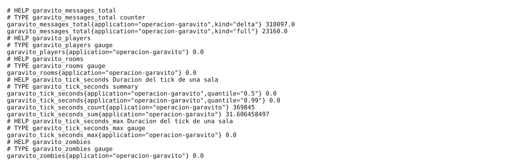
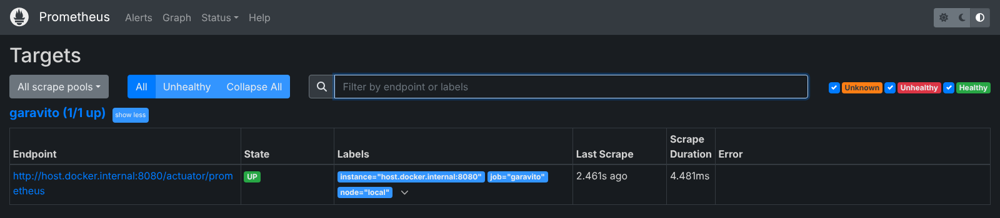
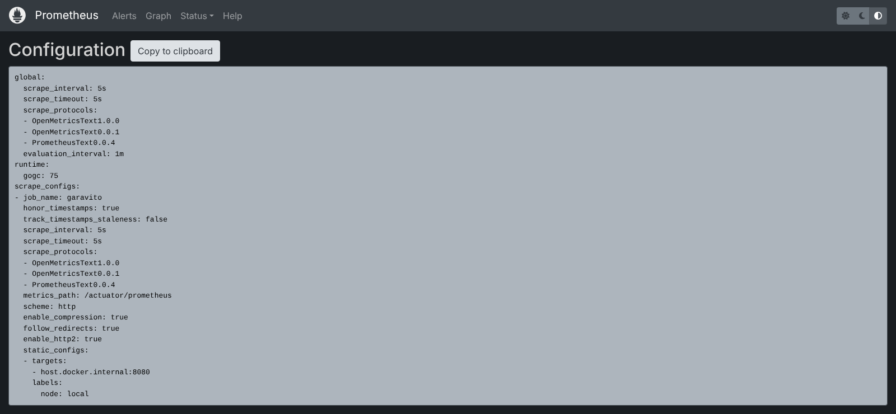
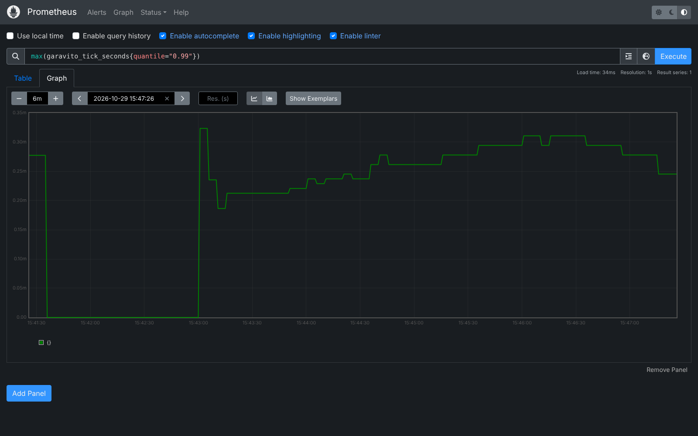
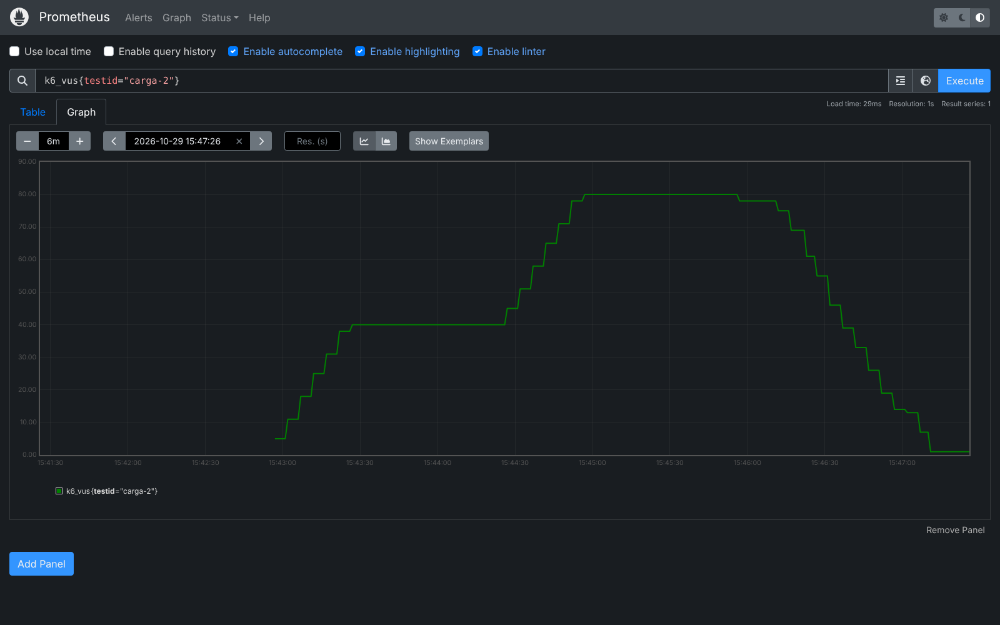

# Prometheus — métricas del servidor

Prometheus recoge cada 5 segundos las métricas del backend y las guarda como series de
tiempo. Grafana las lee para dibujar los tableros (ver [`docs/grafana`](../grafana/README.md))
y k6 le envía las suyas durante las pruebas de carga (ver [`docs/k6`](../k6/README.md)).

Las capturas de esta página son de una corrida real del perfil `carga` de k6 (hasta
80 jugadores en 20 salas), hecha el 29-10-2026 con el backend, Prometheus, Grafana y k6
en la misma máquina (Linux, 4 núcleos, 16 GB, JDK 21, perfil `dev`).

## 1. Cómo encaja

```
                 cada 5 s: GET /actuator/prometheus
  ┌────────────┐ ◀──────────────────────────────── ┌──────────────┐  PromQL   ┌─────────┐
  │  Backend   │                                    │  Prometheus  │ ◀──────── │ Grafana │
  │ Spring Boot│                                    │    :9090     │           │  :3000  │
  │  :8080     │                                    └──────────────┘           └─────────┘
  └────────────┘                                           ▲
        ▲                                                  │ remote write (push)
        │ WebSocket / STOMP + HTTP                         │ POST /api/v1/write
        └──────────────────────────── k6 ──────────────────┘
```

- **Modelo pull:** el backend no envía nada; solo expone un endpoint de texto y
  Prometheus lo consulta (*scrape*). Si el backend se cae, Prometheus lo marca `DOWN`.
- **Remote write:** k6 corre poco tiempo y no tiene un endpoint fijo, así que en vez de
  esperar a que lo consulten, **empuja** sus métricas. Para eso Prometheus arranca con
  `--web.enable-remote-write-receiver`.

## 2. Qué expone el backend

El backend usa Spring Boot Actuator con `micrometer-registry-prometheus`
(`backend/pom.xml`). En `application.properties`:

```properties
management.endpoints.web.exposure.include=health,info,metrics,prometheus
management.metrics.tags.application=operacion-garavito
```

Con eso `GET http://localhost:8080/actuator/prometheus` devuelve todas las métricas en
el formato de texto de Prometheus. Además de las del JVM (memoria, hilos, GC), el CPU
del proceso y las peticiones HTTP, registramos **métricas propias del juego** en
`GameSessionService.setMeterRegistry`:

| Métrica | Tipo | Qué mide |
|---|---|---|
| `garavito_rooms` | gauge | Salas abiertas en este nodo. |
| `garavito_players` | gauge | Jugadores sentados en alguna sala (incluye a los que se cayeron y aún tienen 30 s para volver). |
| `garavito_zombies` | gauge | Zombis vivos, sumando todas las salas. |
| `garavito_tick_seconds{quantile="0.5"\|"0.99"}` | summary | Cuánto tarda **un** tick de **una** sala (se corre cada 66 ms). Con `_count`, `_sum` y `_max`. |
| `garavito_messages_total{kind="full"\|"delta"}` | counter | Estados enviados completos o como delta (solo lo que cambió). |



*Lo que devuelve `/actuator/prometheus`, filtrado a las métricas `garavito_*`. Se tomó
al terminar la prueba, por eso salas y jugadores están en 0. Los contadores acumulan
desde que arrancó el backend (varias corridas): 12 353 estados completos frente a
166 895 deltas, es decir, un 93 % de los mensajes fueron livianos.*

## 3. Configuración

Todo está en [`monitoring/`](../../monitoring):

| Archivo | Para qué |
|---|---|
| `monitoring/prometheus.yml` | Qué consulta Prometheus y cada cuánto. |
| `monitoring/docker-compose.yml` | Levanta Prometheus 2.54.1 y Grafana 11.2.0. |

`monitoring/prometheus.yml`:

```yaml
global:
  scrape_interval: 5s          # cada 5 s pide las métricas

scrape_configs:
  - job_name: garavito
    metrics_path: /actuator/prometheus
    static_configs:
      - targets: ["host.docker.internal:8080"]   # el backend, visto desde el contenedor
        labels:
          node: local                            # etiqueta que usan los tableros
```

- `host.docker.internal` es el equipo anfitrión visto desde dentro del contenedor (el
  `docker-compose.yml` lo declara con `extra_hosts`). Si el backend corre en otra
  máquina, se cambia por su IP.
- Para el modo de varios nodos (`docker-compose.cluster.yml`, nodos en 8081 y 8082) ya
  están los dos destinos comentados, cada uno con su etiqueta `node`.
- 5 s es más fino que el valor por defecto (1 min) porque una partida dura minutos y
  queremos ver los picos.

## 4. Cómo levantarlo

```bash
# 1. Backend (perfil dev, H2 en memoria)
cd backend && ./mvnw spring-boot:run -Dspring-boot.run.profiles=dev
```

```bash
# 2. Prometheus + Grafana
docker compose -f monitoring/docker-compose.yml up -d
```

3. Abrir `http://localhost:9090/targets`: el destino `garavito` debe estar **UP**.



*Status → Targets. El backend responde en ~4 ms y Prometheus lo consultó hace 193 ms.*

En Status → Configuration se ve la configuración que realmente cargó Prometheus:



## 5. Consultas PromQL que usamos

Se escriben en la pestaña **Graph** (`http://localhost:9090/graph`). Las mismas
consultas alimentan los paneles de Grafana.

| Pregunta | PromQL |
|---|---|
| ¿Cuántos jugadores hay? | `sum(garavito_players)` |
| ¿Cuántas salas? | `sum(garavito_rooms)` |
| ¿Cuánto tarda el tick (peor sala, p99)? | `max(garavito_tick_seconds{quantile="0.99"})` |
| ¿Cuántos estados por segundo enviamos, por tipo? | `sum by (kind) (rate(garavito_messages_total[1m]))` |
| ¿Qué porcentaje son deltas? | `100 * sum(rate(garavito_messages_total{kind="delta"}[1m])) / sum(rate(garavito_messages_total[1m]))` |
| ¿Cuánto CPU usa el backend? | `process_cpu_usage` |
| ¿Cuánta memoria del heap? | `sum(jvm_memory_used_bytes{area="heap"}) / sum(jvm_memory_max_bytes{area="heap"})` |
| ¿Cuántos usuarios virtuales tiene k6? | `k6_vus` |

`rate(x[1m])` convierte un contador que solo crece en "por segundo" promediado en el
último minuto; `sum by (kind)` agrupa por la etiqueta `kind`.

### Jugadores durante la prueba


*Se ven las dos rampas del perfil `carga`: 40 jugadores (10 salas) durante un minuto y
luego 80 (20 salas). El máximo que registró el servidor fue 79, coherente con los 80
usuarios virtuales de k6.*

### Duración del tick (p99)



*El p99 del tick no pasó de ~0,32 ms con 80 jugadores. El tick se repite cada 66 ms,
así que el juego usa menos del 1 % de ese margen: la lógica del juego no es el cuello
de botella.*

### Mensajes por segundo, por tipo

![sum by (kind) (rate(garavito_messages_total[1m]))](img/05-mensajes-por-tipo.png)

*Casi todo lo que sale son deltas; los estados completos solo se mandan cuando alguien
entra o se reconecta.*

### Métricas que envió k6 (remote write)



*`k6_vus` no lo consulta Prometheus: lo empuja k6 mientras corre. Cada serie trae la
etiqueta `testid` para separar corridas; aquí se filtra a `carga-2`, la corrida de
esta página.*

## 6. Resultados de la corrida `carga`

| Medida (servidor) | Valor |
|---|---|
| Jugadores simultáneos (máx.) | 79 |
| Salas simultáneas (máx.) | 26 (20 llenas + salas que se estaban cerrando entre rondas) |
| Tick p99 (máx.) | 0,32 ms |
| CPU del proceso (máx.) | 11 % |
| Errores de scrape | 0 |

Los resultados del lado del cliente (latencias, umbrales) están en [`docs/k6`](../k6/README.md).

## 7. Problemas comunes

| Síntoma | Causa y solución |
|---|---|
| Target `DOWN` con `connection refused` | El backend no está corriendo o no está en el puerto 8080. Cambiar el destino en `prometheus.yml` y reiniciar Prometheus. |
| Target `DOWN` con `404` | Falta exponer el endpoint: revisar `management.endpoints.web.exposure.include`. |
| k6 dice `remote write ... 404` | Prometheus arrancó sin `--web.enable-remote-write-receiver` (ya va en el `docker-compose.yml`). |
| En Linux no resuelve `host.docker.internal` | Usar Docker 20.10 o superior (el `docker-compose.yml` ya trae `extra_hosts: host-gateway`). |
