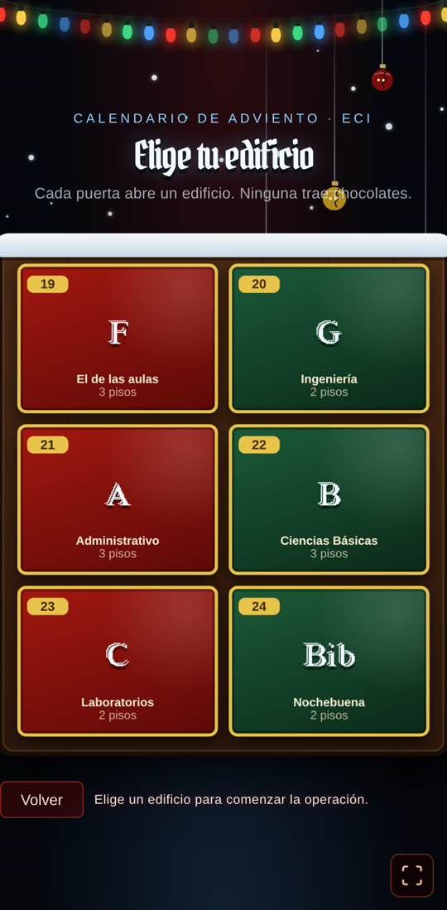
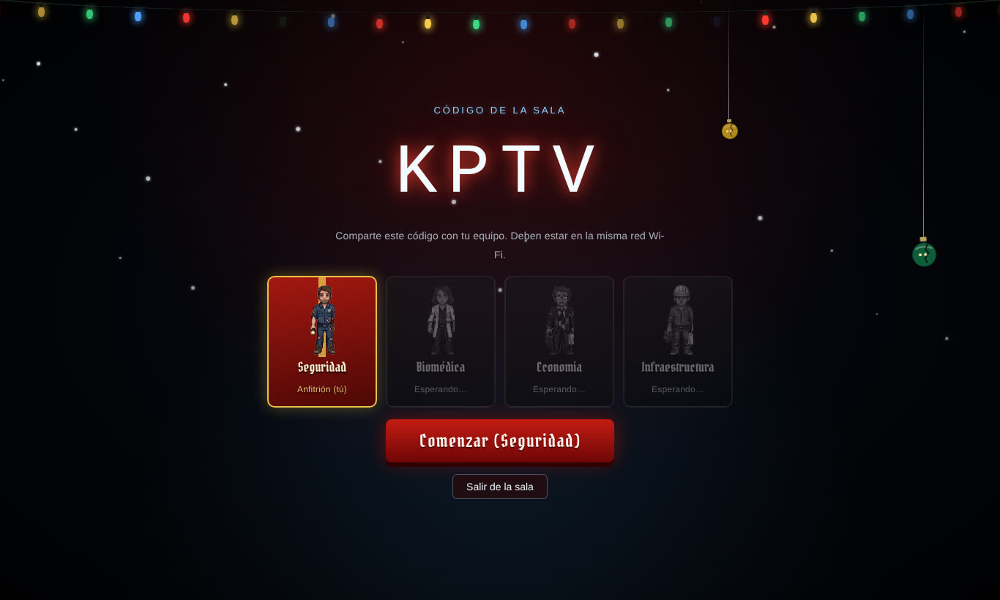
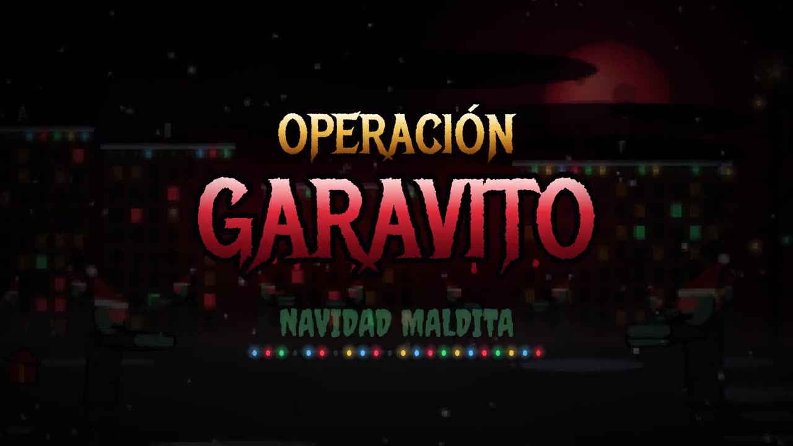
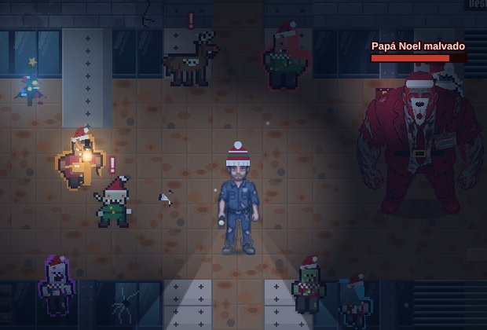
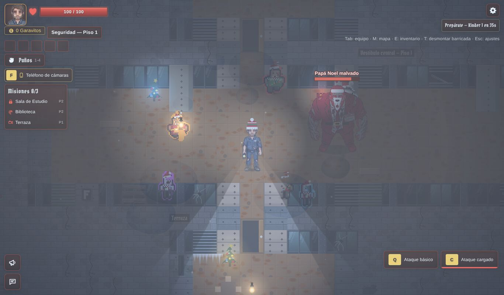
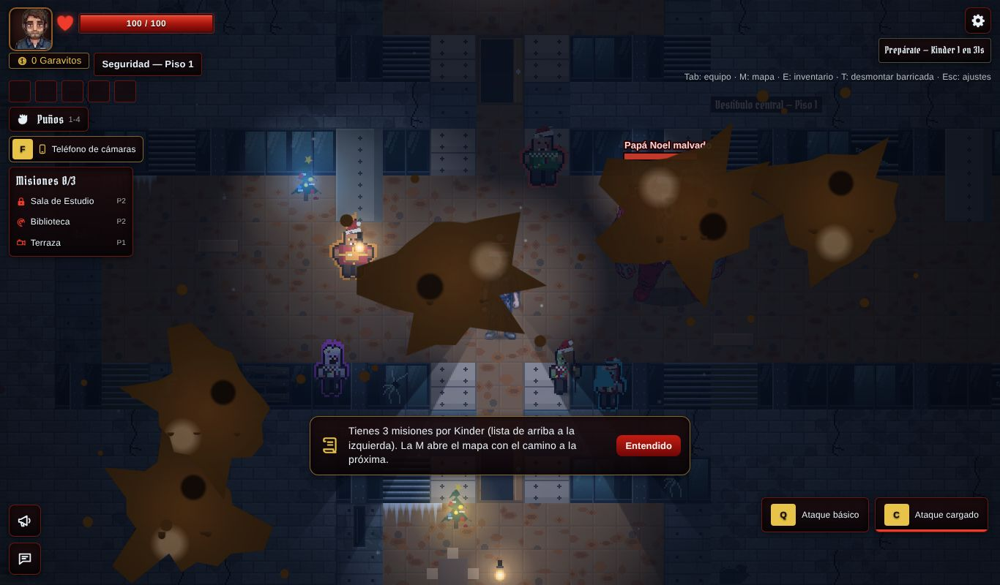
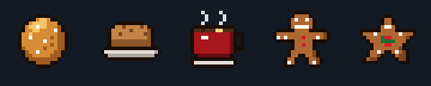
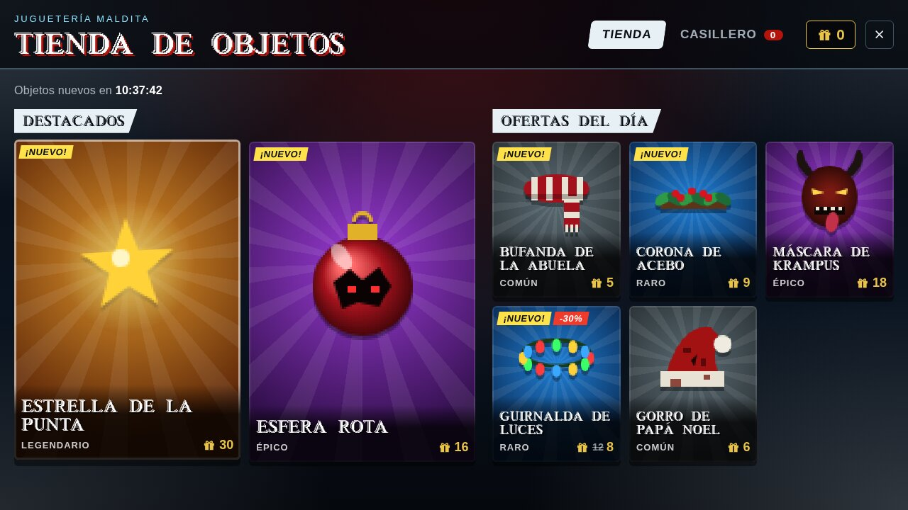
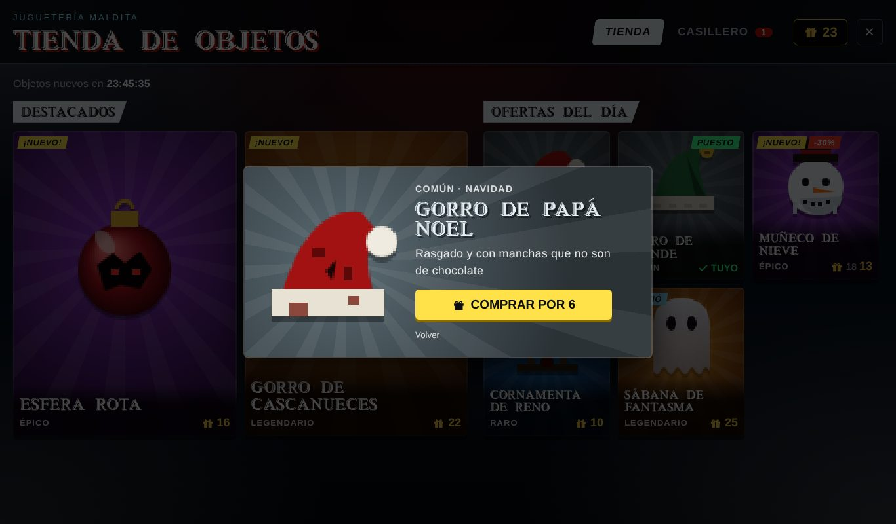
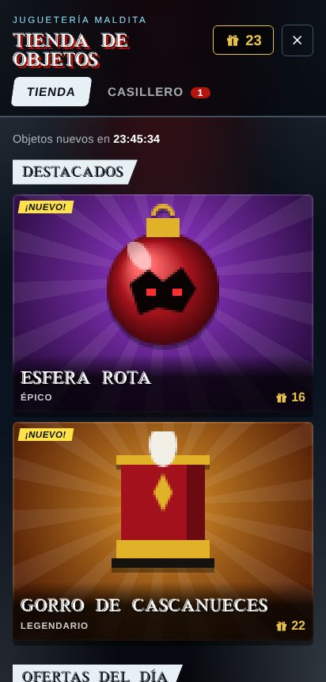

# Navidad sangrienta

El juego está ambientado en **Navidad sangrienta**: sigue dando miedo, pero con nieve,
luces que fallan y regalos que nadie debería abrir.

Hasta noviembre de 2026 había dos temporadas y Halloween (la versión original) se podía
elegir como evento. Se retiró para que el juego cargue y corra más liviano: ver
[SOLO-NAVIDAD.md](SOLO-NAVIDAD.md). Lo que queda de Halloween es el tema base
(`frontend/src/tema.css`, paleta `--hw-*` y fuentes), que `navidad.css` recolorea.

## Cómo funciona

`<html data-temporada="navidad">` va fijo en `frontend/index.html` y activa las reglas
de `navidad.css`. Los textos y la moneda (regalos) están en `frontend/src/game/navidad.js`.
El servidor no sabe de ambientación: Papá Noel malvado y las travesuras de duendes y
renos están siempre activos.

## Qué tiene

### Menús

- **Fondo:** la vista nocturna del campus (`public/mapa/campus-noche.jpg`) con filtro de
  invierno, nieve que cae y una guirnalda de luces que falla.
- **Criaturas:** copos de nieve y esferas rotas que bajan de su hilo con ojos adentro
  (`NavidadCreatures.jsx`).
- **Pantallas hechas con código:**
  - **Selección de edificio:** un **calendario de adviento maldito**. Cada edificio es
    una puerta del 19 al 24 de diciembre; al pasar por encima se entreabre y adentro
    asoman ojos rojos.
  - **Sala de juego:** dos **cartas a Papá Noel** con sello de cera, una para crear la
    sala y otra para unirse con el código, y un regalo que tiembla.
  - **Elegir rol:** cada rol es una **caja de regalo** con lazo dorado que se destapa
    al pasar por encima.
  - **Sala de espera:** cada puesto ocupado se envuelve como regalo. El código brilla
    entre azul helado y rojo.
  - **Resultados:** panel frío con nieve acumulada encima.

### Intro

La primera vez en la sesión el juego abre con el video de intro, **"Navidad
maldita"** (~38 s, con sonido): el duelo por la Decanatura y la presentación del juego.
Se puede saltar o activar el sonido; al terminar, el menú queda sobre el campus de
noche.

El video está en `frontend/public/video/intro-navidad.mp4` (720p, ~5 MB, recomprimido
para la web) y su primer cuadro en `intro-navidad-poster.jpg`. Lo muestra
`MainMenu.jsx`.

La música, en el menú y en la partida, es **"We Wish You a
Merry Christmas"** (villancico tradicional en inglés, de dominio público) en La menor
armónica: la caja de música rota, un coro grave durante el Kinder y un eco desafinado
cuando hay peligro (`game/villancico.js`).

### Partida

- **Decorado** (`game/NavidadDecor.js`): arbolitos de Navidad marchitos con luces que
  titilan y fallan, regalos abiertos a la fuerza y carámbanos de hielo en las esquinas.
  Las posiciones salen de una semilla por edificio y piso, así que todos ven lo mismo.
- **Nieve** que cae alrededor del jugador.
- **Luz fría:** la oscuridad es azul helada (`Lighting.js`) y un velo sobre el mapa
  enfría el piso y las luces cálidas sin apagar el rojo de la sangre.
- **Zombis navideños:** gorro de Papá Noel rasgado (sale volando cuando mueren) y un
  **suéter navideño feo** distinto por tipo, con una tira de luces que titila al
  caminar. El explosivo va envuelto como regalo (`zombieArt.js`).
- **Personajes con gorrito:** quien no lleva nada de la tienda se ve con un gorrito de
  lana a rayas con pompón.

#### Papá Noel malvado (Kinder 3)

Al empezar el **Kinder 3** aparece **Papá Noel malvado**: un jefe más débil
que el Ingeniero de Sistemas (70% de vida, algo más lento, muerde menos) que suelta su
"¡JO, JO, JO!" mientras persigue. Ese Kinder se pasa con la cuota, las misiones **y**
derribándolo.

| Pieza | Archivo |
|---|---|
| Qué jefe es y cómo se ajusta | `BossKind.java` (viaja en `BossView.kind`) |
| Kinder del jefe intermedio | `WaveDirector.setMidBossKinder`, `GameSession.PAPA_NOEL_KINDER` |
| Dibujo | `public/bosses/boss_santa.png`, generado con `tools/sprites/boss_santa.py` desde las poses del jefe (traje rojo, cinturón, gorro y barba) |

#### Duendes y renos

Durante un Kinder, cada 9 a 16 s sale **de la nada** (en una nube de nieve y
con un **!** encima) un **duende** cerca de un jugador; desde el Kinder 2 puede ser un
**reno zombi**. Se queda un instante y tira hacia donde estaba el jugador: si se movió,
la esquiva.

- **Bola de nieve del duende:** deja la pantalla en blanco y se aclara en ~1 s. No
  quita vida.
- **Barro con carbón del reno:** salpica la pantalla con manchas que escurren y tardan
  unos segundos en caerse, y quita 3 de vida.

Lo decide el servidor (`Travesuras.java`): dónde aparece cada bicho, el recorrido de
la bola y a quién le pega. Viaja en el estado como `travesuras` y el cliente lo dibuja
(`TravesurasLayer.js`, pixel art en `travesurasArt.js`); el efecto en la pantalla del
golpeado está en `screenFx.js`.

#### Comida de diciembre

La comida que cura es la de diciembre en Colombia. Cura lo mismo y cuesta lo
mismo (el servidor usa los mismos ids); solo cambia cómo se ve y se llama
(`game/comidas.js`):

| Comida del servidor | Cómo se ve |
|---|---|
| Empanada (+20) | Natilla |
| Arepa (+15) | Buñuelo |
| Energizante (+10) | Chocolate caliente |
| Gaseosa (+5) | Galleta de jengibre |
| Comida del mapa | Buñuelos, natilla, chocolate con queso y galletas (flotando) |

Pixel art generado con `tools/sprites/comidas_navidad.py`.

### Sonido

En la música generada (`game/music.js`) suena "We Wish You a Merry
Christmas" en tono de terror (ver arriba). Durante el Kinder suman **cascabeles de
trineo** al pulso.

### Tienda de objetos

Desde el menú (botón dorado **Tienda de objetos**, justo debajo de Jugar) se abre una
tienda que **cambia cada medianoche** y es la misma para todos ese día:

- **Destacados:** dos objetos épicos o legendarios.
- **Ofertas del día:** cinco más (uno con **30% de descuento**).
- Cartas del color de su **rareza** (común, raro, épico, legendario), etiquetas de
  **¡Nuevo!**, cuenta regresiva hasta la próxima rotación y un **casillero** con lo
  comprado para ponérselo o quitárselo.

Se paga con los **regalos** que suelta la horda. Hay 11 objetos: gorro de Papá Noel, gorro de duende,
bufanda de la abuela, cornamenta, corona de acebo, guirnalda de luces, esfera rota,
muñeco de nieve, máscara de Krampus, gorro de cascanueces y estrella de la punta. Lo que
uno se pone lo ven todos en la partida.

La rotación sale de mezclar el catálogo con la fecha como semilla (`tiendaDelDia` en
`game/costumes.js`); la pantalla está en `components/ItemShop.jsx`.

## Pruebas

| Prueba | Qué verifica |
|---|---|
| `CandyCostumeTest` (backend) | Se aceptan los objetos de la tienda. |
| `GameSessionZombieTest` (backend) | Papá Noel aparece en el Kinder 3 y hay que derribarlo para pasarlo. |
| `TravesurasTest` (backend) | El duende aparece con línea de visión, su bola le pega a quien no se mueve y se esquiva moviéndose; el barro quita vida; solo hay travesuras en un Kinder activo. |
| `comidas.test.js` | La comida de Navidad cura y cuesta lo mismo, y toda la del mapa tiene su dibujo. |
| `costumes.test.js` | La tienda es la misma todo el día y rota entre días, con 2 destacados y 5 diarios (uno en oferta); se compra al precio de oferta. |
| `e2e/partida.spec.js` | El menú abre con el video de intro y se puede saltar. |
