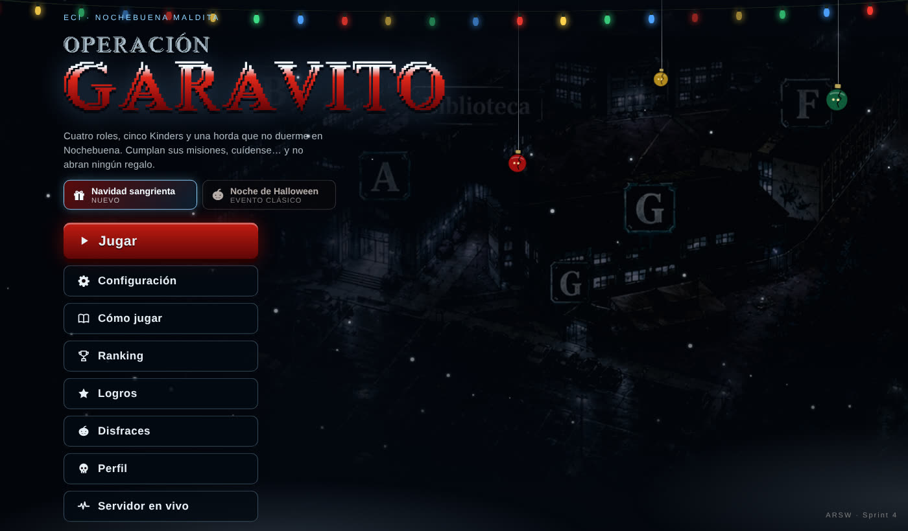
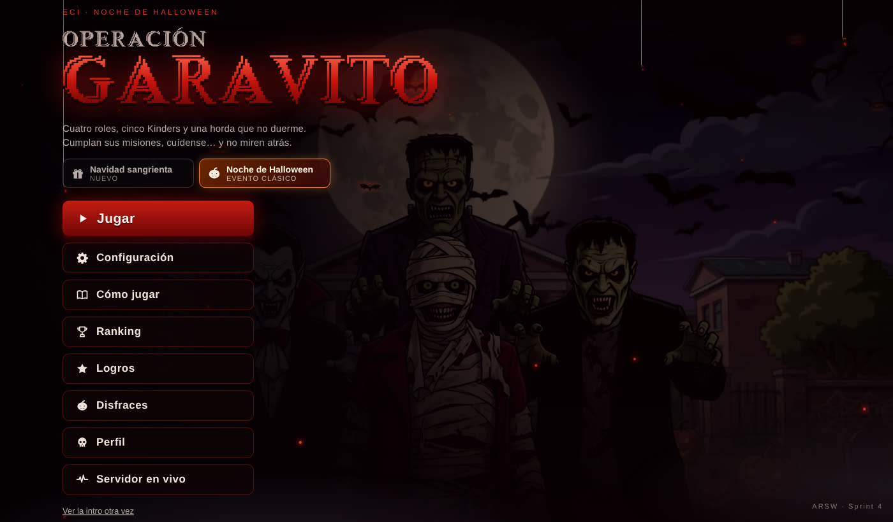
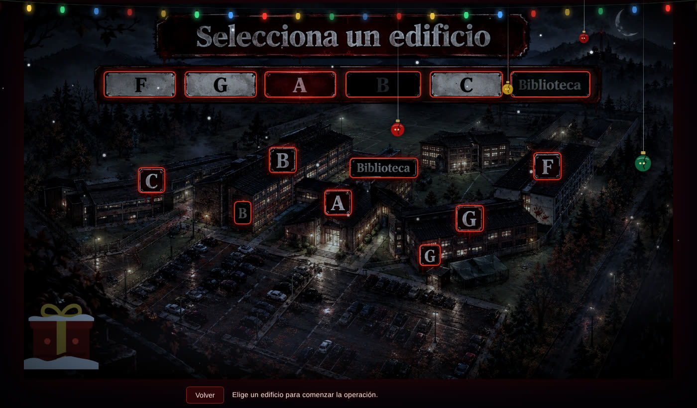
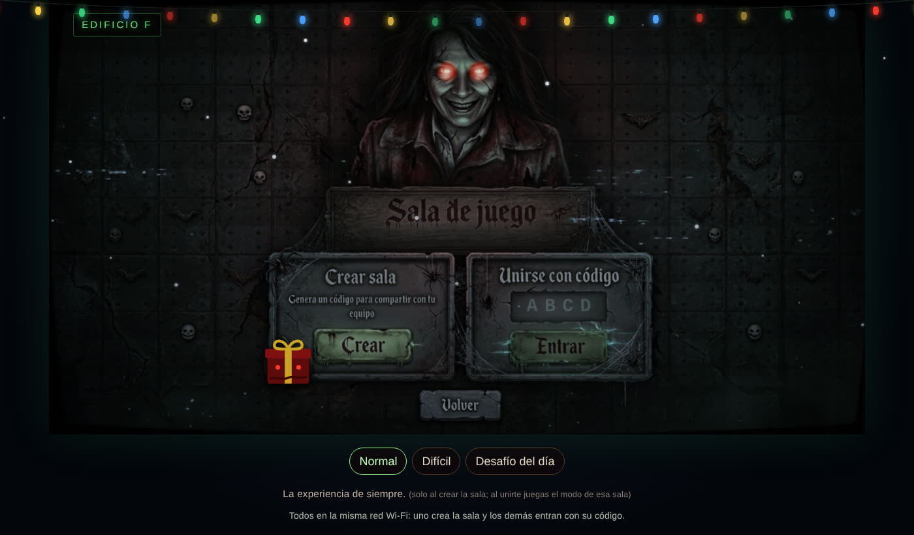
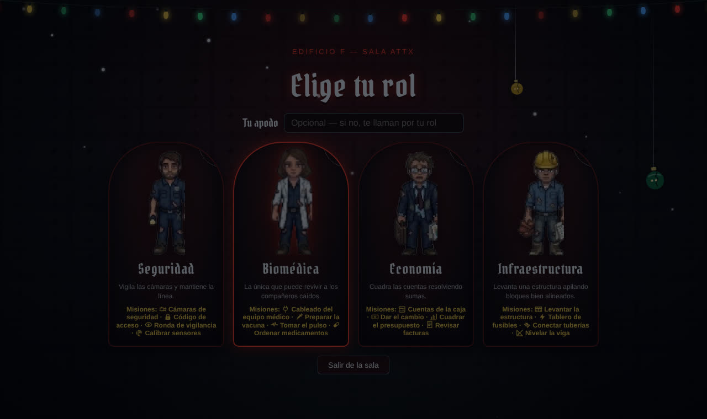
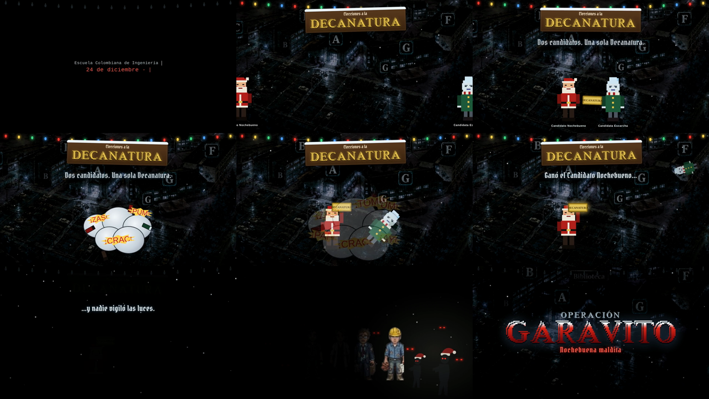
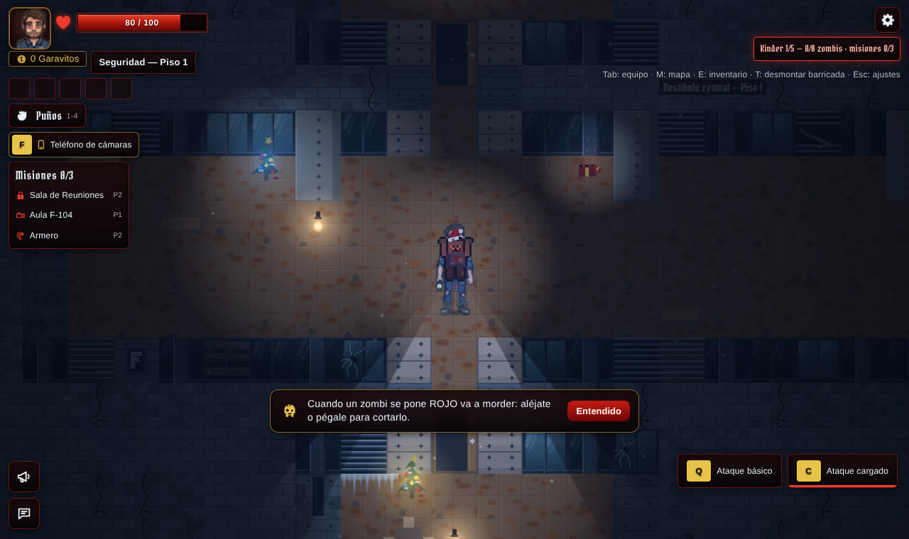
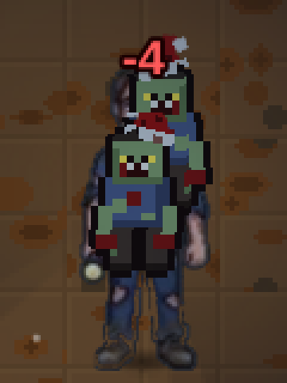
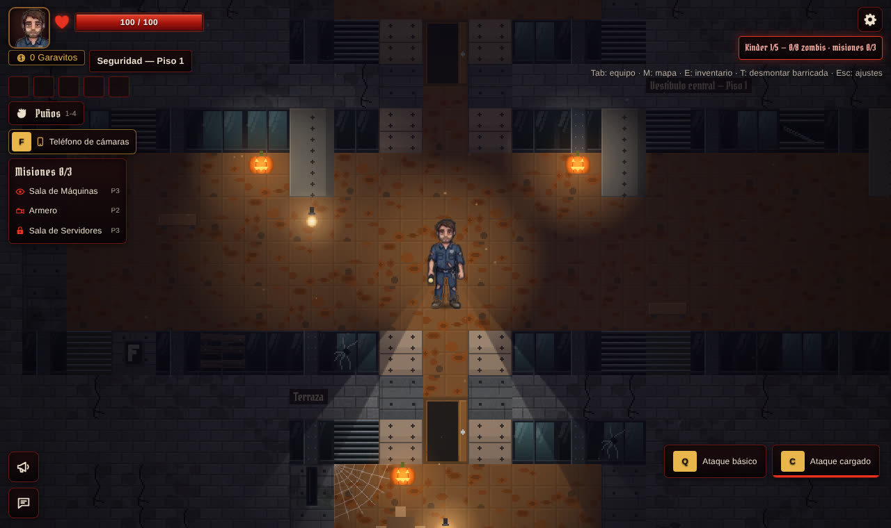
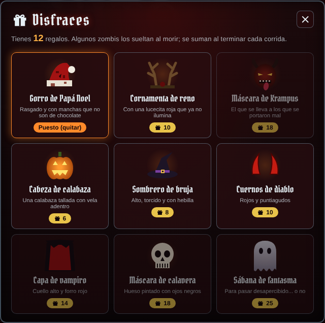

# Temporadas: Navidad sangrienta y Noche de Halloween

El juego tiene **temporadas** (eventos): la misma partida con otra ambientación, como
las listas de juego por evento de los shooters. La temporada actual es **Navidad
sangrienta**: sigue dando miedo, pero con nieve, luces que fallan y regalos que nadie
debería abrir. **Halloween**, la versión original, queda como evento para quien lo
quiera jugar.

Las reglas no cambian: los roles, las misiones, los Kinders, los zombis y el jefe son
los mismos. Solo cambia lo que se ve y se oye.

## Cómo se elige

En el menú principal, debajo del título, están los dos eventos. La elección se guarda
en el navegador (`localStorage`, clave `garavito.temporada.v1`). Si nunca se eligió
nada, la temporada es Navidad.





**Dentro de una sala manda la temporada de la sala.** La elige quien la crea y la ven
igual todos los que entran, aunque cada uno tenga otra preferida. Al salir de la sala,
cada jugador vuelve a la suya. Así nadie juega una partida de Navidad mientras su
compañero ve calabazas.

## Cómo funciona

```
menú (preferida, localStorage) ──crear sala──▶ /app/game/{código}/lobby { …, temporada }
                                                     │
                                       GameSession.temporada (NAVIDAD | HALLOWEEN)
                                                     │
                           LobbyState.temporada en cada estado del juego
                                                     │
            gameSync ─▶ setTemporadaDeSala() ─▶ <html data-temporada="navidad|halloween">
                                                     │
                     CSS (navidad.css) · React (useTemporada) · Phaser (getTemporada)
```

| Pieza | Archivo | Qué hace |
|---|---|---|
| Temporada de la sala | `backend/.../game/Temporada.java`, `GameSession`, `LobbyState` | Se fija al crear la sala (por defecto `NAVIDAD`) y viaja en el estado del lobby. |
| Preferida y activa | `frontend/src/game/temporada.js` | Catálogo de temporadas, preferencia guardada y la de la sala cuando hay una. |
| React | `frontend/src/components/useTemporada.js` | Hook que redibuja el componente si cambia la temporada. |
| Estilos | `frontend/src/navidad.css` | Reemplaza la paleta de Halloween (`--hw-*`) y los fondos cuando `data-temporada="navidad"`. |

## Qué cambia en Navidad

### Menús

- **Fondo:** la vista nocturna del campus en vez del video de Halloween, con filtro de
  invierno, nieve que cae y una guirnalda de luces que falla.
- **Criaturas:** donde Halloween tiene murciélagos y arañas, Navidad tiene copos de
  nieve y esferas rotas que bajan de su hilo con ojos adentro
  (`NavidadCreatures.jsx`).
- **Ilustraciones:** la selección de edificio y la sala usan las mismas imágenes con
  un velo helado. Las calabazas dibujadas quedan tapadas por un **regalo maldito** que
  tiembla y parpadea (`RegaloMaldito.jsx`). En la sala, los ojos de la profesora
  brillan en rojo.







### Intro animada

La primera vez en la sesión, Navidad abre con una intro animada de ~20 s (Halloween
conserva su video). Se puede saltar, y con "Activar sonido" suena sincronizada:

1. "Escuela Colombiana de Ingeniería · 24 de diciembre · 23:58", escrito a máquina.
2. El campus nevado. Las luces se encienden y cae el cartel **"Elecciones a la
   Decanatura"**.
3. Dos candidatos **inventados** (el Candidato Nochebueno y la Candidata Escarcha) se
   pelean por la placa de la Decanatura en una nube de caricatura ("¡ZAS!", "¡PUM!",
   "¡CRAC!"). Gana Nochebueno y Escarcha sale volando.
4. "…y nadie vigiló las luces": apagón, ojos rojos en la oscuridad y la horda con
   gorros.
5. Una linterna encuentra a los cuatro roles y cae el título "Nochebuena maldita".

Video de la intro (con audio): [`intro-navidad.mp4`](intro-navidad.mp4).



Todo está hecho con código: `IntroNavidad.jsx` (escenas), `introNavidad.css`
(animación), `CandidatosDecanatura.jsx` (personajes en pixel art con SVG),
`introNavidadTiempos.js` (la línea de tiempo que comparten la animación y el sonido)
e `introNavidadAudio.js` (efectos con Web Audio). Los personajes son ficticios y no
representan a nadie real.

La música de Navidad, en el menú, en la partida y en la intro, es **"We Wish You a
Merry Christmas"** (villancico tradicional en inglés, de dominio público) en La menor
armónica: la caja de música rota, un coro grave durante el Kinder y un eco desafinado
cuando hay peligro (`game/villancico.js`).

### Partida

- **Decorado** (`game/NavidadDecor.js`): arbolitos de Navidad marchitos con luces que
  titilan y fallan, y regalos abiertos a la fuerza, en los mismos lugares donde
  Halloween pone calabazas. Hay carámbanos de hielo donde iban las telarañas. Las
  posiciones salen de una semilla por edificio y piso, así que todos ven lo mismo.
- **Nieve** que cae alrededor del jugador, en lugar de las motas de polvo.
- **Luz fría:** la oscuridad es azul helada (`Lighting.js`) y un velo sobre el mapa
  enfría el piso y las luces cálidas sin apagar el rojo de la sangre.
- **Zombis con gorro de Papá Noel**, rasgado y manchado, que sale volando cuando
  mueren (`ZombieLayer.js`).





Halloween dentro de la partida sigue exactamente igual que antes:



### Sonido

En la música generada (`game/music.js`), Navidad toca "We Wish You a Merry
Christmas" en tono de terror (ver arriba). Durante el Kinder suman **cascabeles de
trineo** al pulso.

### Moneda y disfraces

- Lo que suelta la horda se llama **regalos** en Navidad y **dulces** en Halloween. Es
  la misma bolsa: no se pierde nada al cambiar de temporada.
- **Disfraces nuevos:** gorro de Papá Noel, cornamenta de reno y máscara de Krampus.
  Se pueden comprar y usar en cualquier temporada; la tienda muestra primero los del
  evento que se está jugando.



## Pruebas

| Prueba | Qué verifica |
|---|---|
| `TemporadaTest` (backend) | Navidad por defecto, la sala guarda la temporada con que se creó y entrar a una sala no se la cambia. |
| `CandyCostumeTest` (backend) | Se aceptan los disfraces de Navidad. |
| `temporada.test.js` | Preferencia guardada, prioridad de la sala sobre la preferida y aviso de cambios. |
| `costumes.test.js` | La tienda ordena por temporada sin repetir disfraces. |
| `e2e/temporada.spec.js` | Elegir Halloween en el menú y que un invitado con Navidad vea la temporada de la sala (y vuelva a la suya al salir). |
| `e2e/partida.spec.js` | Navidad entra sin video; Halloween conserva su intro. |

## Agregar otra temporada

1. Un valor nuevo en `Temporada.java` y su entrada en `TEMPORADAS` (`temporada.js`):
   nombre, textos y moneda.
2. Un CSS con `:root[data-temporada='nueva']` (como `navidad.css`).
3. En `MainScene`, `Lighting`, `ZombieLayer` y `music.js`, la rama de la nueva
   temporada, donde haga falta.
